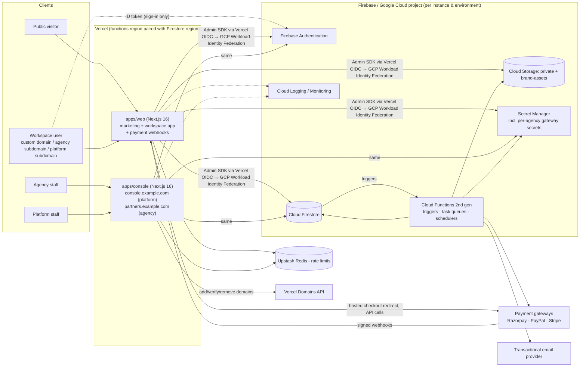
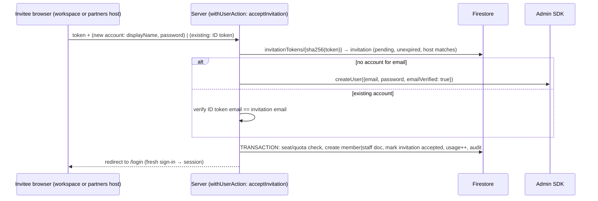
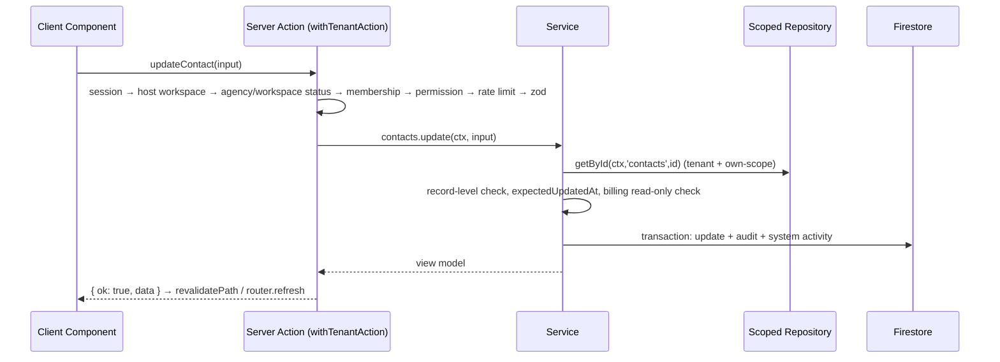

# 02 — System Architecture

> **Prev:** [01 Product Requirements](01-product-requirements.md) · **Next:** [03 Database Schema](03-database-schema.md)
> v1.1 — revised for owner answers (Vercel hosting, agency hierarchy, custom domains, payment gateways, own-only Member visibility, MFA deferred, multi-instance deployments).
> Platform facts were checked on 2026-10-09 (Next.js 16.3 is the current stable line; Firebase Admin SDK `createSessionCookie`/`verifySessionCookie(checkRevoked)`; Firestore PITR 7 days and scheduled backups). Items marked **(verify)** must be re-checked in the Phase 1 spike (T-01-09) before code depends on them.

## Contents

1. [Architecture overview](#1-architecture-overview)
2. [Repository and App Router structure](#2-repository-and-app-router-structure)
3. [Host routing and the proxy](#3-host-routing-and-the-proxy)
4. [Firebase Authentication integration](#4-firebase-authentication-integration)
5. [Firestore and Admin SDK integration](#5-firestore-and-admin-sdk-integration)
6. [Server vs Client Components, Server Actions, Route Handlers](#6-server-vs-client-components-server-actions-route-handlers)
7. [Multi-tenant isolation strategy](#7-multi-tenant-isolation-strategy)
8. [API design, validation, errors, logging](#8-api-design-validation-errors-logging)
9. [Background processing](#9-background-processing)
10. [Architecture Decision Records](#10-architecture-decision-records)
11. [Environments and instances](#11-environments-and-instances)
12. [Caching strategy](#12-caching-strategy)
13. [Payments architecture](#13-payments-architecture)
14. [Custom domain architecture](#14-custom-domain-architecture)

---

## 1. Architecture overview

One **instance** (A-12) = one Vercel project set + one Firebase/GCP project in one region. The diagram shows one instance.



**Key properties**

- The browser **never** talks to Firestore or Cloud Storage directly in MVP (ADR-003). It talks to Firebase Auth only to sign in, then exchanges the ID token for a session cookie.
- All data access goes through server code with the Admin SDK, which **bypasses Security Rules**. Server authorization is the primary control; deny-all rules are defense in depth.
- Hosting (Vercel) and data (GCP) are separate clouds: the Vercel function region must be paired with the Firestore region (e.g., Vercel `iad1` ↔ GCP `us-east1`/`us-east4`), and credentials use keyless federation (ADR-007).
- Long-running or fan-out work runs in Cloud Functions inside GCP (co-located with Firestore), triggered by Firestore job documents or schedules.
- Card/bank data never touches our systems: gateways' hosted pages only (NFR-SEC-011).

## 2. Repository and App Router structure

**[PROPOSED] pnpm workspace monorepo** (ADR-016). Two Vercel projects (`web`, `console`) built from the same repo.

```
/
├─ apps/
│  ├─ web/                         # marketing + workspace CRM + payment webhooks
│  │  ├─ src/
│  │  │  ├─ proxy.ts               # Next 16 proxy (formerly middleware) — host classification & rewrite only
│  │  │  ├─ app/
│  │  │  │  ├─ (marketing)/        # www host: /, /features, /agencies, /pricing, /security, /docs/[...slug], /legal/*, /contact, /find-workspace
│  │  │  │  ├─ _t/[host]/          # INTERNAL rewrite target for every workspace host (never linked directly)
│  │  │  │  │  ├─ (auth)/          # /login, /reset-password, /invite/[token] (account creation happens here)
│  │  │  │  │  └─ (app)/           # authenticated CRM — layout calls requireTenantContext()
│  │  │  │  │     ├─ dashboard/ contacts/ companies/ leads/ deals/ tasks/ reports/ notifications/ trash/
│  │  │  │  │     └─ settings/ (general|profile|members|branding|pipeline|billing|audit|privacy|data)
│  │  │  │  ├─ api/
│  │  │  │  │  ├─ auth/session/route.ts                 # POST create, DELETE sign-out (workspace hosts)
│  │  │  │  │  ├─ notifications/route.ts                # GET poll
│  │  │  │  │  ├─ files/[jobId]/route.ts                # signed-URL redirect for exports
│  │  │  │  │  ├─ webhooks/[provider]/[agencyId]/route.ts  # payment webhooks (signature-verified)
│  │  │  │  │  ├─ health/route.ts
│  │  │  │  │  └─ unsubscribe/route.ts
│  │  │  │  ├─ robots.txt/route.ts             # host-aware
│  │  │  │  └─ sitemap.xml/route.ts            # www host only
│  │  │  ├─ features/<module>/                  # contacts, companies, leads, deals, tasks, activities, billing, ...
│  │  │  │  ├─ components/  actions.ts ('use server', wrapped)  queries.ts (server-only reads)
│  │  │  └─ ui/                                 # app-specific composites (shell, nav)
│  └─ console/                     # one app, two host contexts
│     └─ src/app/
│        ├─ _platform/ ...         # console.example.com — platform staff (agencies, workspaces, plans, gateways, domains, instance health)
│        └─ _agency/ ...           # partners.example.com — agency staff (their workspaces, branding, domains, billing, staff)
├─ packages/
│  ├─ core/                        # server-only: session, contexts (tenant/agency/platform), authz, repositories, services, audit, rate-limit, logger, email, payments/, domains/
│  ├─ shared/                      # isomorphic: zod schemas, permissions, types, money/date utils, branding theme
│  ├─ ui/                          # design-system components
│  └─ testing/                     # fixtures, factories, emulator helpers, gateway mocks
├─ functions/                      # Cloud Functions (jobs, schedulers, triggers, reconciliation, migrations)
├─ firebase/                       # firestore.rules, storage.rules, firestore.indexes.json, firebase.json
├─ instances/                      # instance registry (non-secret config per instance: region, domains, project IDs)
├─ e2e/                            # Playwright suites
└─ requirements/                   # this plan
```

Layering rules (ESLint `no-restricted-imports` / boundaries):

| Layer | May import | Must not import |
|-------|-----------|-----------------|
| `app/**` pages/layouts | `features/*/queries`, `features/*/components`, `packages/ui`, `packages/shared` | `firebase-admin`, repositories directly |
| `features/*/actions.ts` | `packages/core` action wrappers + services, `packages/shared` | `firebase-admin` directly |
| `packages/core/services` | repositories, audit, payments, domains, shared | Next.js request APIs (receive context as argument) |
| `packages/core/repositories` | Admin SDK | anything from `app/` |
| Client components (`'use client'`) | `packages/ui`, `packages/shared`, server actions by reference | `packages/core` (guarded by `import 'server-only'`) |

## 3. Host routing and the proxy

Next.js 16 renamed `middleware.ts` to `proxy.ts` **(verify exact runtime semantics on Vercel in T-01-01)**. The proxy only classifies hosts and rewrites — never authorizes (middleware-only auth has had real bypasses, e.g. CVE-2025-29927).

```mermaid
flowchart TD
  R[Incoming request] --> H{Host header class}
  H -- "www.example.com / apex" --> M[Marketing routes\nblock /_t/* → 404]
  H -- "console.example.com / partners.example.com" --> C[apps/console project]
  H -- "{slug}.app.example.com\n{slug}.{agency base domain}\nany other host" --> T[Treat as candidate workspace host:\nrewrite /path → /_t/{host}/path\nX-Robots-Tag: noindex\nno-store for non-static]
  T --> L[Server layout: resolveWorkspaceByHost(host)\n→ tenantDomains/{host} verified & active?]
  L -- no --> N[Neutral 404]
  L -- yes --> CTX[requireTenantContext]
```

- Because custom domains are arbitrary, the proxy cannot allowlist them by pattern; **verification happens in the server layout** against `tenantDomains/{host}` (status `active`, cached 60 s). Vercel only routes domains registered on the project, which is a second gate.
- Email links and redirects are built from the workspace's stored **canonical host**, never from the request `Host` header (prevents host-header poisoning).
- Platform subdomain of a workspace that has an active custom domain 301-redirects to the canonical host (except `/api/*`).

## 4. Firebase Authentication integration

### 4.1 Decision summary
- **Single Firebase Auth user pool** per instance; workspace membership and agency staff records live in Firestore (ADR-002).
- **No Identity Platform upgrade for now** ([CONFIRMED], OQ-10) → no MFA; compensating controls FR-AUTH-008 ([04 §4](04-security-and-compliance.md#4-authentication-and-session-management)).
- **Accounts created only server-side** during invitation acceptance (`adminAuth.createUser`), never by the client SDK (FR-AUTH-001).
- **Session cookies** from Admin SDK (`createSessionCookie`, 5 min – 14 days), verified with `verifySessionCookie(cookie, checkRevoked)` (ADR-005). Host-only cookies → one session per host.

### 4.2 Sign-in and session sequence (workspace host)

```mermaid
sequenceDiagram
  autonumber
  participant U as Browser (workspace host)
  participant FA as Firebase Auth (client SDK)
  participant S as Next.js server (POST /api/auth/session)
  participant AD as Admin SDK
  participant FS as Firestore
  U->>FA: signInWithEmailAndPassword / Google (if host authorized)
  FA-->>U: ID token (short-lived)
  U->>S: POST idToken + CSRF token (same-origin)
  S->>S: rate-limit(ip, email-hash); verify Origin + CSRF
  S->>AD: verifyIdToken(idToken, checkRevoked=true)
  AD-->>S: claims (uid, email_verified, auth_time)
  S->>S: require auth_time < 5 min; email_verified
  S->>FS: tenantDomains/{host} → tenantId; tenants/{tid} (+ agency status); tenants/{tid}/members/{uid}
  alt active member & workspace & agency active
    S->>AD: createSessionCookie(idToken, expiresIn)
    S-->>U: Set-Cookie __Host-session (HttpOnly, Secure, SameSite=Lax, Path=/)
    S->>FS: audit auth.session_created
    U->>FA: signOut() locally (persistence NONE)
  else not member
    S-->>U: 403 NO_MEMBERSHIP (generic page)
  end
```

Console hosts use the same pattern with `requirePlatformContext()` / `requireAgencyContext()` instead of membership, shorter lifetimes, Google-only sign-in with domain allowlist for platform staff, and login alerts (FR-AUTH-008). The marketing host has **no sessions** (no public sign-up).

### 4.3 Invitation acceptance (account creation)



### 4.4 Per-request verification

```ts
// PSEUDOCODE — packages/core/session.ts (server-only)
export const getSession = cache(async (): Promise<Session | null> => {
  const raw = (await cookies()).get(SESSION_COOKIE_NAME)?.value
  if (!raw) return null
  try {
    const claims = await adminAuth.verifySessionCookie(raw, /* checkRevoked */ true)
    return { uid: claims.uid, email: claims.email, emailVerified: claims.email_verified,
             authTime: claims.auth_time, provider: claims.firebase?.sign_in_provider }
  } catch { return null }
})
```

`cache()` memoizes per request only. Revocation check costs one Auth backend round trip per request; measured in T-09-06.

### 4.5 Authorized domains (risk R-02)
Firebase Auth requires the page origin to be an **authorized domain** for OAuth popup/redirect flows, and continue URLs in email action links must be on authorized domains **(verify; assume no wildcards)**. Plan:
1. Domain onboarding job (§14) adds each activated custom domain / workspace subdomain to the project's authorized domains via the Identity Toolkit project-config Admin API **(verify API availability without Identity Platform and the maximum number of domains in T-01-09)**.
2. If limits are hit: email/password remains available everywhere; Google sign-in is shown only on authorized hosts (FR-AUTH-002); a central auth host with one-time handoff (bound to uid, host, 60 s, single use, nonce cookie) is the documented fallback (ADR change → H2).

## 5. Firestore and Admin SDK integration

- Admin SDK initialized once per function instance in `packages/core/firebase-admin.ts`.
- **Credentials on Vercel (ADR-007):** Vercel OIDC token → GCP **Workload Identity Federation** → impersonate a per-project service account; no JSON key stored **(verify Vercel OIDC + `google-auth-library` external-account config in T-01-09)**. Fallback if federation is not workable: service-account key in a Vercel *sensitive* environment variable, least-privilege roles, 90-day rotation, alerting on key use from unknown IPs.
- Cloud Functions use their runtime service account (ADC, no keys).
- Local development uses emulators only (`demo-` project ID, no credentials).
- Workspace data under `tenants/{tenantId}/…` (ADR-004); agency data under `agencies/{agencyId}/…`. Repositories receive a typed context and build paths from it only.

```ts
// PSEUDOCODE — packages/core/repositories/base.ts
export function tenantCollection<T>(ctx: TenantContext, name: TenantCollectionName) {
  return db.collection('tenants').doc(ctx.tenantId).collection(name).withConverter(converterFor<T>(name))
}

// Member own-only scope (FR-RBAC-004, ADR-023) — applied to EVERY list/search/aggregate query
export function scopedQuery<T>(ctx: TenantContext, name: OwnedCollection): Query<T> {
  let q = tenantCollection<T>(ctx, name).where('isDeleted', '==', false)
  if (READ_SCOPE[ctx.role] === 'own') q = q.where(OWNER_FIELD[name], '==', ctx.uid)   // ownerUid | assigneeUid
  return q
}

export async function getById<T>(ctx: TenantContext, name: TenantCollectionName, id: string) {
  assertSafeId(id)
  const snap = await tenantCollection<T>(ctx, name).doc(id).get()
  if (!snap.exists || snap.get('isDeleted') === true) throw new NotFoundError()
  if (snap.get('tenantId') !== ctx.tenantId) { logger.error({ msg: 'tenant_mismatch', ...ctx.log, id }); throw new NotFoundError() }
  if (!canReadRecord(ctx, name, snap)) throw new NotFoundError()       // own-scope check for Members
  return snap.data()!
}
```

## 6. Server vs Client Components, Server Actions, Route Handlers

| Use | Choose | Rules |
|-----|--------|-------|
| Pages, layouts, lists, detail views, dashboards | **Server Components** | Fetch via `features/*/queries.ts` → context + scoped repositories. Map documents to view models; never pass internal fields to clients. |
| Interactivity (forms, kanban drag, dialogs, combobox, charts) | **Client Components** | Small; serializable props; no secrets; no Firestore SDK. |
| Mutations from UI | **Server Actions** | Always via a wrapper (§6.1). Server Actions are public POST endpoints. Return `ActionResult`. |
| Session, polling, downloads, **payment webhooks**, health, robots/sitemap, unsubscribe | **Route Handlers** | Explicit methods; Origin/CSRF check on state-changing browser endpoints; webhooks authenticated by signature instead; `Cache-Control: private, no-store` on authenticated responses. |
| Heavy/long work (> ~10 s, > 500 writes, external retries) | **Cloud Functions** via job docs | Server Action only creates the job document after authorization. |

### 6.1 Server Action wrapper

```ts
// PSEUDOCODE — packages/core/actions/withTenantAction.ts
export function withTenantAction<S extends ZodSchema, R>(opts: {
  permission: Permission
  schema: S
  rateLimit?: RateLimitPolicy
  reauth?: boolean                              // FR-AUTH-004 AC5 / FR-AUTH-008 AC3
  handler: (ctx: TenantContext, input: z.infer<S>) => Promise<R>
}) {
  return async (rawInput: unknown): Promise<ActionResult<R>> => {
    const requestId = newRequestId()
    try {
      const ctx = await requireTenantContext({ requestId })   // session + host workspace + agency/workspace status + membership
      authorize(ctx, opts.permission)
      if (opts.reauth) assertRecentAuth(ctx.session, 300)
      if (opts.rateLimit) await enforceRateLimit(opts.rateLimit, ctx)
      const input = opts.schema.strict().parse(rawInput)       // never trusts tenantId/agencyId/role/ownerUid from input
      return { ok: true, data: await opts.handler(ctx, input) }
    } catch (e) {
      return toActionError(e, requestId)
    }
  }
}
```

**Wrapper family** (all share validation, rate limiting, error mapping, audit, and are registered in the isolation/authz test registry):

| Wrapper | Host | Requires |
|---------|------|----------|
| `withTenantAction` | workspace hosts | session + active workspace & agency + active membership + permission |
| `withUserAction` | workspace or partners host | authenticated user, no tenant context — only for: accept invitation, delete own account, update own profile |
| `withAgencyAction` | `partners.example.com` | session + active agency staff record + agency permission; agencyId from staff record |
| `withPlatformAction` | `console.example.com` | session from allowlisted Google Workspace domain + `platformAdmins/{uid}` + platform permission |

`requireTenantContext()`:
1. `getSession()` → none ⇒ `UnauthenticatedError`.
2. Resolve workspace from **host** (`tenantDomains/{host}`, status `active`; 60 s cache).
3. Read `tenants/{tenantId}` and its `agencies/{agencyId}` (60 s cache) → both `active` (else `TenantSuspendedError`).
4. Read `tenants/{tenantId}/members/{uid}` (**no cross-request cache**) → `active`.
5. Return `{ agencyId, tenantId, uid, role, permissions, readScope, entitlements, billingState, requestId, log }`.

## 7. Multi-tenant isolation strategy

Defense in depth — each layer independently prevents cross-workspace and cross-agency access:

| Layer | Control |
|-------|---------|
| Routing | Workspace determined by verified host mapping; `_t/[host]` cannot be requested directly. Agency determined from staff record, not host. |
| Session | Host-only `__Host-` cookies; never shared between workspace hosts, partners, or console. |
| Context | `requireTenantContext` / `requireAgencyContext` / `requirePlatformContext` per host class. |
| Data access | Repositories derive paths from context; documents carry `tenantId`/`agencyId` checked on read. |
| Record scope | Members: mandatory `ownerUid == uid` on queries and reads (ADR-023). |
| Input | Schemas reject `tenantId`, `agencyId`, `role`, `ownerUid` (except reassign actions validating membership). |
| References | Referenced IDs loaded through the same scoped repository → foreign/invisible IDs resolve to NotFound. |
| Queries | Collection-group queries only in Functions (system jobs) or with mandatory `tenantId`/`agencyId` equality (lint + review). |
| Agency console | Reads workspace **metadata** only (tenant root doc, usage, subscription); no repository access to CRM subcollections from agency context (enforced by types: `AgencyContext` cannot construct `TenantContext`). |
| Webhooks | agencyId from URL is only a lookup key for the secret; signature must verify; workspace mapping from our subscription records. |
| Caching | No shared caching of tenant data; config caches keyed by IDs. |
| Rules | Deny-all client rules for Firestore and Storage. |
| Background jobs | IDs derived from document paths, never payload. |
| Logs | Every log line carries agencyId/tenantId; no record contents. |
| Tests | Isolation suites (TC-SEC-001, -012, -013, -015, TC-AGY-003, TC-RBAC-004) on every PR. |

## 8. API design, validation, errors, logging

### 8.1 Result and error contract

```ts
type ActionResult<T> =
  | { ok: true; data: T }
  | { ok: false; error: { code: ErrorCode; message: string; fieldErrors?: Record<string, string[]>; requestId: string } }

type ErrorCode = 'UNAUTHENTICATED' | 'FORBIDDEN' | 'NOT_FOUND' | 'VALIDATION' | 'CONFLICT'
  | 'RATE_LIMITED' | 'PLAN_LIMIT_EXCEEDED' | 'TENANT_SUSPENDED' | 'BILLING_READ_ONLY'
  | 'REAUTH_REQUIRED' | 'INTERNAL'
```

Route Handlers map to HTTP 401/403/404/400/409/429 (+`Retry-After`)/403/403/402-or-403 (`BILLING_READ_ONLY`, decide in T-06-12)/401/500. Cross-tenant/agency or invisible-record access returns **404** (no existence oracle).

### 8.2 Validation
Zod schemas in `packages/shared/schemas` used by forms and re-parsed on server. Optimistic concurrency via `expectedUpdatedAt` → `CONFLICT`.

### 8.3 Logging
JSON lines to stdout → Vercel log drains forwarded to Google Cloud Logging (or the chosen log sink, verify drain support on the Vercel plan); Functions log natively to Cloud Logging. Fields: `severity, message, requestId, instance, agencyId, tenantId, uid, route, action, latencyMs, errorCode`. Redaction: no emails, names, phones, record contents, tokens, cookies, gateway payloads. Errors to Sentry (OQ-11) with scrubbing.

### 8.4 Request data flow (mutation)



## 9. Background processing

| Job | Trigger | Implementation | Idempotency |
|-----|---------|----------------|-------------|
| CSV import | `tenants/{t}/jobs/{id}` (`import`) | Firestore trigger → task-queue function per 500-row chunk | `jobId:chunkNo` |
| List/tenant export | job doc | stream to private bucket; signed URL | job state machine |
| Email send | `mailOutbox/{id}` | provider API; retries; dead-letter | outbox id as idempotency key |
| Task reminders | every 5 min | collection-group Q25 (`reminderAt <= now`, `reminderSentAt == null`); tenantId from doc path; non-active tenants skipped | `reminderSentAt` set in transaction |
| Trash purge | daily | per tenant, batched | re-runnable |
| Tenant / agency purge | daily | recursive delete after grace | re-runnable + post-check |
| Usage reconciliation | nightly | `count()` aggregations → counters | overwrite |
| **Payment reconciliation** | nightly | fetch subscription state from gateway per active subscription; fix drift; alert | overwrite + audit |
| **Payment webhook processing** | webhook Route Handler stores verified event → `paymentEvents/{id}` → trigger function applies state change | event id |
| **Domain verification** | domain doc created / every 10 min while pending (≤ 72 h) | poll Vercel Domains API; on success add Firebase authorized domain; set `active` | status machine |
| **Orphan account cleanup** | daily | Auth users with no membership/staff record and older than 7 days → flag/delete | re-runnable |
| Denormalized name fan-out | `onDocumentUpdated` | batched updates | re-runnable |
| Pipeline stage removal | job doc | move deals then remove stage | re-runnable |
| TTL cleanup | Firestore TTL on `expireAt` | managed (async ~24 h, leaf docs only — verify) | n/a |

Functions: 2nd gen, region = Firestore region, `maxInstances` capped, retries only on idempotent handlers.

## 10. Architecture Decision Records

Status **Proposed** until Phase 0 approval. "Revised" rows reflect owner answers of 2026-10-09.

| ID | Decision | Alternatives considered | Trade-offs |
|----|----------|------------------------|-----------|
| **ADR-001** | Next.js 16 (App Router), React 19, TypeScript `strict`. Pin exact minor in T-01-01. | Remix/React Router, SvelteKit | Confirmed by owner; RSC reduces client JS. |
| **ADR-002** *(revised)* | Single Firebase Auth pool per instance + Firestore memberships/staff records; **no Identity Platform for now** (MFA deferred). | Identity Platform multi-tenancy; Auth.js/Clerk | Multi-workspace users supported; MFA gap mitigated by FR-AUTH-008 (R-15). |
| **ADR-003** | **Server-mediated data access only**; client SDK for Auth only; deny-all rules; notifications by polling. | Client SDK reads with tenant rules (real-time) | One enforcement model; no real-time listeners. |
| **ADR-004** | Shared Firestore database per instance; workspace data in `tenants/{tenantId}/…` + redundant `tenantId`; agency data in `agencies/{agencyId}/…`; tenants carry `agencyId`. | Root collections; database-per-tenant | Path-scoped isolation, easy recursive delete/export. |
| **ADR-005** | Admin SDK session cookies, host-only, `__Host-` prefix (no cookie-name restriction on Vercel — verify), 5-day default. | ID token per request; NextAuth | httpOnly, revocable; revocation check latency. |
| **ADR-006** | Authorization source of truth = membership / staff docs read per request; no custom claims for roles. | Roles in custom claims | Immediate effect of changes; one extra read per request. |
| **ADR-007** *(revised)* | **Host on Vercel** ([CONFIRMED]). GCP access via Vercel OIDC → Workload Identity Federation (no keys); Vercel function region paired with Firestore region; Cloud Functions remain on GCP for triggers/schedules. | Firebase App Hosting; self-managed Cloud Run | + Mature custom-domain API, previews, CDN. − Cross-cloud latency/egress; federation setup; domain limits by Vercel plan (verify); Firestore triggers still need GCP. |
| **ADR-008** | Cloud Functions 2nd gen for background work. | Vercel Cron + queue; Cloud Run jobs | Triggers need GCP; Vercel Cron acceptable only for light pings. |
| **ADR-009** | Zod for shared validation schemas. | Valibot, Yup | Mature, TS inference. |
| **ADR-010** | Search MVP = prefix tokens (`searchTokens` + `array-contains`), with own-scope variant for Members; external engine post-MVP. | External engine now | Lower ops/cost; prefix-only UX. |
| **ADR-011** | Tailwind CSS + Radix-based owned components in `packages/ui`; CSS-variable theming. | MUI, Chakra | Tokens map to agency/workspace branding. |
| **ADR-012** | Email via provider-agnostic `EmailSender` + outbox; provider must support per-agency verified sender domains (OQ-06). | Firebase Trigger Email extension | Swappable vendor; retries; audit. |
| **ADR-013** | Rate limiting with Upstash Redis (Vercel Marketplace), sliding window; fail-closed for auth/privileged endpoints. Vercel Firewall rules as an extra layer (verify plan features). | Firestore counters | Low latency from Vercel. |
| **ADR-014** | Money as integer minor units + ISO currency (incl. INR paise). | Decimal strings | Exact arithmetic; `sum()` works. |
| **ADR-015** | Firestore auto-IDs; slugs separate and immutable in MVP. | ULIDs | No hotspotting. |
| **ADR-016** | pnpm monorepo; Node.js 24 LTS (verify Vercel + Cloud Functions runtime support). | Single app | Separates console from workspace app. |
| **ADR-017** *(revised)* | Observability: Sentry (Vercel integration) + Vercel log drain → Cloud Logging; Cloud Monitoring for GCP side; uptime checks. | Datadog | Two clouds → unified sink required. |
| **ADR-018** *(revised)* | Console app separate from workspace app, serving platform (`console.`) and agency (`partners.`) contexts; privileged-account controls per FR-AUTH-008 instead of MFA (for now). | Route groups in main app | Smaller blast radius; IP allowlist possible. |
| **ADR-019** *(new)* | **Multi-instance deployment model**: one codebase, many independent instances (each own Firebase project, Vercel projects, region, domains, secrets). Shared instance by default; dedicated per client when region/isolation requires. Releases roll out to all instances from the same tag. | Single global instance; instance per agency always (OQ-19) | Supports per-client regions ([CONFIRMED] OQ-04); ops overhead grows with instances (R-18). |
| **ADR-020** *(new)* | **Agency → workspace hierarchy** with separate agency console and agency staff roles; agency staff have metadata-only access to client workspaces. | Flat tenants with "reseller" flag | Clean reseller model; agency CRM access only via explicit membership (privacy). |
| **ADR-021** *(new)* | **Payment gateway abstraction**: `PaymentGateway` interface; adapters Razorpay (first), PayPal, Stripe; per-agency credentials in Secret Manager; hosted checkout only; webhook-driven state with gateway re-fetch. | Single gateway (Stripe Billing) | Matches per-client gateway requirement; more adapter/testing work. |
| **ADR-022** *(new)* | **Custom domains via Vercel Domains API** + `tenantDomains` registry + authorized-domain sync; host verified server-side. | Cloudflare for SaaS custom hostnames | Native to chosen host; check per-project domain limits and wildcard nameserver requirement. |
| **ADR-023** *(new)* | **Member own-only visibility enforced in the repository layer** (`scopedQuery`, `canReadRecord`) with owner-prefixed composite indexes. | UI filtering; separate per-user collections | Single chokepoint; ~doubles list indexes (R-04). |

Any change to an approved ADR requires a new ADR superseding it and human approval ([08 §7](08-ai-agentic-development-workflow.md#7-human-approval-checkpoints)).

## 11. Environments and instances

**Environments** (per instance):

| Env | Firebase project | Vercel | Data | Access |
|-----|-----------------|--------|------|--------|
| **local** | Emulator Suite (`demo-crm`) | `next dev` | Seeded fixtures | Developers/agents |
| **dev** | `crm-dev-<id>` — **US region (proposed `us-east1`)**, Blaze with low budget alert (A-14) | Preview deployments | Synthetic | Team |
| **staging** | `crm-staging-<id>` (same region as the prod instance it mirrors) | `staging` branch/environment | Synthetic + UAT | Team + pilot agency |
| **production** | `crm-prod-<instance>` | Production deployment from release tag | Real | Restricted |

**Instances** (ADR-019): registry in `instances/<name>.json` (non-secret): `{ name, region, firebaseProjectIds per env, vercelProjectIds, domains (marketing/app/partners/console), defaultCurrency }`. Example: `shared-us` (Firestore `us-east1`, Vercel `iad1`), future `dedicated-acme-in` (Firestore `asia-south1`, Vercel `bom1`). Data never crosses instances; an agency lives in exactly one instance.

```mermaid
flowchart LR
  DEV[Feature branch] -->|PR + CI gates| MAIN[main]
  MAIN -->|auto| STG[Staging (per instance)]
  STG -->|tag vX.Y.Z + human approval| PROD1[Prod: shared-us]
  STG -->|same tag| PROD2[Prod: dedicated instances]
```

## 12. Caching strategy

| Data | Cache | TTL / invalidation | Notes |
|------|-------|--------------------|-------|
| Marketing pages, docs | Static generation / Vercel CDN | On deploy (or ISR) | Public only |
| Host → workspace mapping, public branding for login | In-memory LRU keyed by host | 60 s | Public branding only |
| Tenant + agency docs (status, plan, settings, billing state) | In-memory LRU keyed by IDs | 60 s; suspension effective ≤ 60 s | Per function instance |
| Membership / staff record | React `cache()` per request only | per request | Changes immediate |
| Authenticated pages & handlers | **None** | `Cache-Control: private, no-store`; dynamic | Prevents CDN leakage (R-05) |
| Next.js `use cache` / Data Cache | **Prohibited** for tenant data unless tenantId is an explicit argument and Security-reviewed | — | CI grep |
| Brand asset files | CDN, immutable content-hash URLs | 1 year | Public by design |

## 13. Payments architecture

```mermaid
sequenceDiagram
  autonumber
  participant O as Workspace Owner
  participant W as apps/web (billing page)
  participant SM as Secret Manager
  participant PG as Gateway (Razorpay/PayPal/Stripe)
  participant WH as /api/webhooks/{provider}/{agencyId}
  participant FS as Firestore
  participant FN as Function: applyPaymentEvent
  O->>W: Choose plan (withTenantAction billing.manage, reauth)
  W->>SM: load agency gateway credentials (cached ≤ 5 min in memory)
  W->>PG: create subscription / checkout session (plan ID from agency price map, notes: tenantId, subscriptionRef)
  PG-->>W: hosted approval URL
  W-->>O: redirect to gateway hosted page
  O->>PG: pays on hosted page (no card data at our side)
  PG-->>O: redirect back → "processing" page (no entitlement change yet)
  PG->>WH: signed webhook event
  WH->>SM: agency webhook secret
  WH->>WH: verify signature over raw body; reject if invalid
  WH->>FS: create paymentEvents/{provider_eventId} (if not exists) → 200
  FS->>FN: onCreate
  FN->>PG: fetch authoritative subscription state
  FN->>FS: TRANSACTION update tenants/{t}/billing/subscription + entitlements + billingHistory + audit
  FN->>FS: notify owner + agency
```

- `PaymentGateway` adapters live in `packages/core/payments/{razorpay,paypal,stripe}` with a shared contract test suite (TC-BILL-001) run against gateway sandboxes nightly and mocks on PRs.
- Exact API names, webhook event types, and signature schemes per gateway are verified against current official docs in T-06-11 before implementation.
- Webhook route: raw body read before parsing; 10 s budget; returns 2xx only after the event is durably stored.

## 14. Custom domain architecture

```mermaid
stateDiagram-v2
  [*] --> pending_dns: staff adds domain (withAgencyAction / withPlatformAction, reauth)
  pending_dns --> verifying: Vercel API addDomain to web project OK
  verifying --> active: DNS verified + TLS issued + Firebase authorized domain added
  verifying --> error: timeout 72 h / conflict (domain used elsewhere)
  error --> verifying: retry
  active --> removing: staff removes
  removing --> [*]: detached from Vercel + authorized domains; mapping deleted
```



- `tenantDomains/{host}` is the source of truth; created `pending_dns`; becomes routable only when `active`.
- A host can belong to one workspace in one instance; conflicts (domain already on another Vercel project) surface as `error` with guidance.
- Agency base domains: wildcard `*.crm.agency.example` requires Vercel nameservers on that domain **(verify)**; otherwise individual subdomains are added per workspace.
- Domain operations are audited at agency and platform level.
