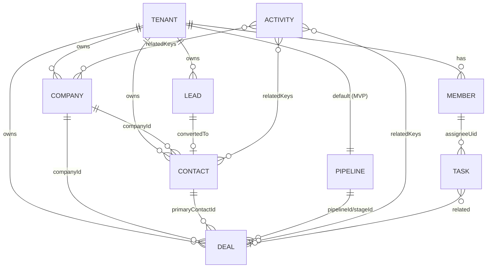

# 03 — Database Schema (Cloud Firestore)

> **Prev:** [02 Architecture](02-system-architecture.md) · **Next:** [04 Security](04-security-and-compliance.md)
> v1.1 — adds agencies, billing, domains, privileged-account data, and Member own-scope indexes.
> Firestore Native mode, single database `(default)` per instance environment project. Location chosen per instance (immutable); development instance in the US (NFR-PRIV-001). Limits cited were checked 2026-10-09 against Google's quotas page; re-verify numeric limits in T-01-09.

## Contents

1. [Design principles](#1-design-principles)
2. [Collection tree](#2-collection-tree)
3. [Common fields](#3-common-fields)
4. [Platform-level collections](#4-platform-level-collections)
5. [Tenant-level collections](#5-tenant-level-collections)
6. [Relationships and references](#6-relationships-and-references)
7. [Access patterns and tenant ownership](#7-access-patterns-and-tenant-ownership)
8. [Query patterns and indexes](#8-query-patterns-and-indexes)
9. [Pagination and search](#9-pagination-and-search)
10. [Firestore limitations and design responses](#10-firestore-limitations-and-design-responses)
11. [Cost optimization](#11-cost-optimization)
12. [Transactions and consistency](#12-transactions-and-consistency)
13. [Retention, deletion, backups, recovery](#13-retention-deletion-backups-recovery)
14. [Migrations](#14-migrations)
15. [Sample documents (fictional)](#15-sample-documents-fictional)

---

## 1. Design principles

1. **Tenant data lives under `tenants/{tenantId}`** (ADR-004). Every tenant document *also* stores `tenantId` (verified on read; enables safe collection-group queries for system jobs).
2. **Server-only access** via Admin SDK (ADR-003). Client rules deny all.
3. **Denormalize for reads** (display names, counts) — Firestore has no joins. Denormalized copies are labeled `*Snapshot` or `*Name` and refreshed by background jobs when the source changes.
4. **Every query shape is declared** in this document and in `firebase/firestore.indexes.json`. No ad-hoc query shapes in code (R-04).
5. **Timestamps** are Firestore `Timestamp` set from server (`FieldValue.serverTimestamp()` for create/update).
6. **Money** in integer minor units (ADR-014).
7. **Schema version** field on every document for migrations.

## 2. Collection tree

```
users/{uid}
platformAdmins/{uid}
plans/{planId}
tenantSlugs/{slug}
agencySlugs/{slug}
tenantDomains/{hostname}                  # every routable host: platform subdomain, agency subdomain, custom domain
invitationTokens/{tokenHash}              # workspace member, workspace owner, and agency staff invitations
handoffTokens/{tokenHash}                 # only if central-auth-host fallback is adopted (02 §4.5)
paymentEvents/{provider_eventId}          # verified webhook events (idempotency, TTL 180 d)
privilegedSessions/{id}                   # console/partners session log for login alerts: uid, context, device fingerprint (TTL 90 d)
revocationTokens/{tokenHash}              # single-use "this wasn't me" links from login alerts: uid, expireAt (TTL)
idempotencyKeys/{uid_key}                 # provisioning/other idempotent requests (TTL 24 h)
mailOutbox/{messageId}
rateLimits/{key}                          # only if Firestore rate-limit option chosen (OQ-07)
platformAuditLogs/{id}
erasureLog/{id}
migrations/{migrationId}
agencies/{agencyId}
  ├─ staff/{uid}
  ├─ invitations/{invitationId}
  ├─ planPrices/{planId}                  # agency price per plan template + gateway plan IDs
  ├─ senderDomains/{domain}               # P2
  └─ auditLogs/{auditId}                  # agency-level actions
tenants/{tenantId}
  ├─ members/{uid}
  ├─ invitations/{invitationId}
  ├─ companies/{companyId}
  ├─ contacts/{contactId}
  ├─ leads/{leadId}
  ├─ deals/{dealId}
  ├─ pipelines/{pipelineId}
  ├─ tasks/{taskId}
  ├─ activities/{activityId}
  ├─ notifications/{notificationId}
  ├─ tagDefinitions/{tagId}
  ├─ emailTemplates/{templateKey}
  ├─ jobs/{jobId}
  ├─ usage/current
  ├─ billing/subscription                 # single doc: current subscription state
  ├─ billingHistory/{entryId}             # payment/invoice summaries from webhooks
  └─ auditLogs/{auditId}
```

## 3. Common fields

Present on all tenant CRM records (companies, contacts, leads, deals, tasks, activities):

| Field | Type | Req | Notes |
|-------|------|-----|------|
| `id` | string | ✓ | Mirrors document ID |
| `tenantId` | string | ✓ | Must equal path segment |
| `ownerUid` | string | ✓ (not activities: `createdBy` acts as owner) | Must be an active member at write time. **Drives Member own-only visibility (ADR-023).** |
| `createdAt` / `updatedAt` | Timestamp | ✓ | Server timestamps |
| `createdBy` / `updatedBy` | string (uid) | ✓ | |
| `isDeleted` | boolean | ✓ | Default `false`; included in all list indexes |
| `deletedAt` / `deletedBy` | Timestamp/string \| null | | Set on soft delete |
| `tags` | string[] | | ≤ 20, normalized lowercase |
| `searchTokens` | string[] | | Prefix tokens (§9.2), ≤ 60 entries |
| `schemaVersion` | number | ✓ | Starts at 1 |

## 4. Platform-level collections

### `users/{uid}`
| Field | Type | Req | Validation / notes |
|-------|------|-----|--------------------|
| `email` | string | ✓ | Mirror of Auth email; lowercase |
| `displayName` | string | | 1–120 |
| `photoPath` | string \| null | | Storage path in brand-assets bucket |
| `timezone` | string | | IANA |
| `theme` | `'system'\|'light'\|'dark'` | | |
| `tenantIds` | string[] | ✓ | Active memberships (for workspace switcher; ≤ 50). Source of truth remains `members` docs. |
| `agencyIds` | string[] | | Agency staff memberships (source of truth: `agencies/{a}/staff`) |
| `createdAt`, `lastLoginAt` | Timestamp | ✓ | |
| `deletionRequestedAt` | Timestamp \| null | | FR-PRIV-003 |

### `platformAdmins/{uid}`
`role: 'superadmin' | 'support'`, `email`, `allowedSignInProvider: 'google.com'`, `createdAt`, `createdBy`, `mfaEnforced: false` (becomes true when Identity Platform is adopted). Written only by a bootstrap script or another superadmin (console). Email domain must match `APP_PLATFORM_STAFF_DOMAINS` (FR-AUTH-008).

### `agencySlugs/{slug}` · `privilegedSessions/{id}`
Agency slug reservation (same rules as tenant slugs). Privileged session log: `uid`, `context ('platform'|'agency')`, `agencyId?`, `ipHash`, `userAgentHash`, `createdAt`, `alertSent`, `expireAt` — used to detect new devices for login alerts.

### `paymentEvents/{provider_eventId}`
`provider`, `agencyId`, `tenantId|null` (resolved from our subscription mapping), `type`, `receivedAt`, `processedAt|null`, `status ('received'|'applied'|'ignored'|'failed')`, `summary` (non-sensitive: subscription ID, status, amount minor units, currency), `expireAt` (TTL 180 d). **Never** stores raw payloads containing customer PII or payment instrument details.

### `plans/{planId}`
`name`, `entitlements: { limits: {seats, records, importRowsPerJob}, features: {reports, import, auditExport}, whiteLabel: {removePoweredBy} }`, `version`, `isPublic`, `trialDays?`.

### `tenantSlugs/{slug}`
`tenantId`, `createdAt`, `status: 'active' | 'quarantined'`, `quarantinedUntil?`. Created in provisioning transaction → uniqueness guarantee.

### `tenantDomains/{hostname}`
| Field | Type | Notes |
|-------|------|-------|
| `tenantId` | string \| null | null for an agency base-domain record |
| `agencyId` | string | owning agency |
| `type` | `'platform_subdomain'\|'agency_subdomain'\|'agency_base'\|'custom'` | |
| `status` | `'pending_dns'\|'verifying'\|'active'\|'error'\|'removing'` | only `active` is routable |
| `isCanonical` | boolean | one canonical host per workspace (used for links/emails) |
| `vercel` | map | `{ projectId, verified, verificationRecords: [{type, name, value}], lastCheckedAt }` |
| `authDomainSynced` | boolean | added to Firebase authorized domains |
| `error` | string \| null | last error code (no secrets) |
| `createdAt`, `createdBy`, `activatedAt` | | |
Document ID is the lowercase hostname (punycode for IDN; dots allowed; no `/`).

### `invitationTokens/{sha256(token)}`
`tenantId`, `invitationId`, `expireAt` (TTL). Lookup without collection-group query.

### `handoffTokens/{sha256(token)}` · `idempotencyKeys/{uid_key}`
Handoff: `uid`, `tenantId`, `host`, `expireAt` (60 s; TTL), `usedAt|null` — redeemed in a transaction, single use. Idempotency: `result` (e.g. `{tenantId}`), `expireAt` (24 h TTL); key = `${uid}_${clientIdempotencyKey}` (key validated `^[A-Za-z0-9_-]{8,64}$`).

### `mailOutbox/{id}`
`tenantId|null`, `template`, `to` (single address), `variables` (escaped at render), `status: queued|sending|sent|failed|dead`, `attempts`, `lastError?`, `createdAt`, `expireAt` (TTL 30 d). Contains PII → TTL short.

### `platformAuditLogs/{id}` · `erasureLog/{id}` · `migrations/{id}`
Platform actions (tenant suspended, plan changed); erasure records (`tenantId`, `contactIdHash`, `erasedAt`) for re-applying after restore; migration run log (`status`, `startedAt`, `finishedAt`, `docsProcessed`, `approvedBy`).

## 5. Tenant-level collections

### `agencies/{agencyId}`
| Field | Type | Req | Notes |
|-------|------|-----|------|
| `name`, `slug` | string | ✓ | |
| `status` | `'active'\|'suspended'\|'pending_deletion'\|'deleted'` | ✓ | Cascades to workspaces |
| `ownerUid` | string | ✓ | Denormalized; staff docs authoritative |
| `quotas` | map | ✓ | `{ maxWorkspaces, maxSeatsTotal }` |
| `entitlements` | map | ✓ | `{ canProvisionWorkspaces: false, allowWorkspaceBranding: true, removePoweredBy }` |
| `branding` | map | ✓ | Same shape as workspace branding; agency defaults |
| `baseDomain` | string \| null | | e.g. `crm.agency-one.example` (tenantDomains type `agency_base`) |
| `billing` | map | ✓ | `{ mode: 'gateway'\|'manual', provider: 'razorpay'\|'paypal'\|'stripe'\|null, env: 'test'\|'live', secretRefs: { apiKey, apiSecret, webhookSecret } (Secret Manager resource **names** only), currency }` |
| `usage` | map | | `{ workspaces, seats }` (reconciled nightly) |
| `createdAt`, `createdBy`, `schemaVersion` | | ✓ | |

### `agencies/{agencyId}/staff/{uid}` · `invitations/{id}` · `planPrices/{planId}` · `senderDomains/{domain}` · `auditLogs/{id}`
- **staff:** `uid, agencyId, email, displayName, role ('agency_owner'|'agency_admin'), status, joinedAt, invitedBy`.
- **invitations:** as workspace invitations, with `role` ∈ agency roles.
- **planPrices:** `planId` (operator template), `amount` (minor units), `currency`, `interval ('month'|'year')`, `gatewayPlanId`, `validatedAt` (fetched from gateway), `active`.
- **senderDomains (P2):** `domain, providerDomainId, status, dnsRecords[], verifiedAt`.
- **auditLogs:** same shape as tenant audit logs with `agencyId`.

### `tenants/{tenantId}`
| Field | Type | Req | Notes |
|-------|------|-----|------|
| `agencyId` | string | ✓ | Owning agency; immutable in MVP |
| `canonicalHost` | string | ✓ | Current canonical host (from `tenantDomains`) |
| `name` | string | ✓ | Legal/display workspace name 1–80 |
| `slug` | string | ✓ | Immutable (MVP) |
| `status` | `'active'\|'suspended'\|'pending_deletion'\|'deleted'` | ✓ | |
| `planId` | string | ✓ | |
| `trialEndsAt` | Timestamp \| null | | |
| `entitlementOverrides` | map | | Platform-admin only |
| `featureFlags` | map<string, boolean> | | Platform-admin only |
| `branding` | map | ✓ | Workspace **overrides** only (`appName?, logo*?, primaryColor?, ...`); effective branding = platform → agency → overrides (FR-AGY-004), cached resolved copy `brandingResolved` updated by trigger when agency branding changes |
| `billingState` | `'trialing'\|'active'\|'past_due'\|'read_only'\|'manual_active'` | ✓ | Denormalized from `billing/subscription` for fast checks |
| `settings` | map | ✓ | `timezone, locale, currency, dateFormat, weekStart, fiscalYearStartMonth` |
| `ownerUid` | string | ✓ | Denormalized for quick checks; members doc is authoritative |
| `deletionRequestedAt`, `deletionScheduledFor` | Timestamp \| null | | |
| `suspendedAt`, `suspendedReason` | | | Reason internal only |
| `createdAt`, `createdBy`, `schemaVersion` | | ✓ | |

### `members/{uid}`
`uid, tenantId, email (snapshot), displayName (snapshot), role ('owner'|'admin'|'manager'|'member'|'viewer'), status ('active'|'disabled'), joinedAt, invitedBy, viaAgencyStaff (bool — true when an agency staff user was invited into the workspace, shown to owners; OQ-21), notificationPrefs {...}, lastSeenAt`.

### `billing/subscription` · `billingHistory/{entryId}`
- **subscription:** `provider, providerCustomerId, providerSubscriptionId, planId, priceRef (agency planPrices id), status ('trialing'|'active'|'past_due'|'cancelled'|'manual'), currentPeriodEnd, cancelAtPeriodEnd, graceEndsAt, paidUntil (manual mode), lastEventId, lastSyncedAt, updatedAt`.
- **billingHistory:** `type ('payment'|'refund'|'invoice'), amount, currency, status, occurredAt, providerRef, receiptUrl? (gateway-hosted), paymentMethodSummary? (e.g. 'card •••• 4242' if gateway provides)`. No card/bank numbers.

### `invitations/{invitationId}`
`email (normalized), role (≠ owner), tokenHash, status ('pending'|'accepted'|'revoked'|'expired'), invitedBy, createdAt, expiresAt, acceptedAt, acceptedBy, resendCount, expireAt (TTL = expiresAt + 30 d)`.

### `companies/{companyId}`
Common fields + `name`, `nameLower`, `domain`, `domainNormalized`, `industry` (enum), `sizeBand` (`'1-10'|'11-50'|'51-200'|'201-1000'|'1000+'`), `phone`, `website`, `address {line1, line2, city, region, postalCode, country}`, `description`, `counts {contacts, openDeals}` (denormalized, eventually consistent), `lastActivityAt`.

### `contacts/{contactId}`
Common fields + `firstName`, `lastName`, `fullNameLower`, `email`, `emailNormalized`, `phones [{label, number, e164?}]` (≤ 3), `jobTitle`, `companyId|null`, `companyName` (snapshot), `lifecycleStage`, `leadSource`, `address`, `doNotContact`, `lastActivityAt`, `convertedFromLeadId?`.

### `leads/{leadId}`
Common fields + `firstName`, `lastName`, `fullNameLower`, `email`, `emailNormalized`, `phone`, `companyName`, `jobTitle`, `source`, `status`, `estimatedValue` (int), `convertedTo {contactId, companyId?, dealId?}?`, `convertedAt?`, `convertedBy?`, `lastActivityAt`.

### `pipelines/{pipelineId}`
`name`, `isDefault: true` (single pipeline MVP), `stages: [{id, name, order, probability, kind: 'open'|'won'|'lost'}]` (≤ 17), `updatedAt`. Small doc, read once per board render.

### `deals/{dealId}`
Common fields + `name`, `nameLower`, `amount` (int minor), `currency`, `pipelineId`, `stageId`, `stageEnteredAt`, `status ('open'|'won'|'lost')`, `probability`, `expectedCloseDate (Timestamp|null)`, `primaryContactId`, `primaryContactName`, `companyId`, `companyName`, `lostReason?`, `lostReasonText?`, `closedAt?`, `lastActivityAt`.

### `tasks/{taskId}`
Common fields (owner = `assigneeUid`; `ownerUid` = assigneeUid for uniform checks) + `title`, `description`, `dueAt|null`, `dueIsDateOnly`, `priority`, `status ('open'|'done')`, `assigneeUid`, `related {type, id, label}|null`, `completedAt`, `reminderAt|null` (computed on write: `dueAt`, or 09:00 in the assignee timezone for date-only tasks), `reminderSentAt|null`.

### `activities/{activityId}`
Common fields (no `ownerUid`; `createdBy`) + `type ('call'|'meeting'|'email'|'note'|'system')`, `systemEvent?` (e.g., `deal.stage_changed`), `subject`, `body` (≤ 10,000), `occurredAt`, `durationMinutes?`, `outcome?`, `related [{type, id, label}]` (1–4), `relatedKeys string[]` (e.g., `['contact:abc','deal:xyz']`), `metadata` (system events: `{from, to}` enums only).

### `notifications/{notificationId}`
`tenantId, recipientUid, type, title (no PII beyond record label), link (relative path), readAt|null, createdAt, expireAt (TTL 90 d)`.

### `tagDefinitions/{tagId}` · `emailTemplates/{templateKey}`
Tag: `name, nameNormalized, color, usageCount`. Email template override: `subject, intro (≤ 500 plain text), updatedAt, updatedBy`.

### `jobs/{jobId}`
`type ('import'|'export'|'tenantExport'|'dsarExport'|'stageMigration'|'leadActivityRelink')`, `status ('queued'|'running'|'succeeded'|'failed'|'partial')`, `params` (validated), `progress {total, processed, failed}`, `resultPath?` (private bucket), `errorReportPath?`, `requestedBy`, `createdAt`, `finishedAt`, `expireAt` (TTL 30 d).

### `usage/current`
`seats, records, contacts, companies, leads, deals, updatedAt, reconciledAt`. Incremented with `FieldValue.increment` in the same transaction as creates/deletes (one write per transaction — within hot-doc guidance at A-06 scale).

### `auditLogs/{auditId}`
| Field | Type | Notes |
|-------|------|------|
| `tenantId` | string | |
| `actor` | `{type: 'user'\|'platform_admin'\|'system', uid?, emailSnapshot?}` | |
| `action` | string | dotted, allowlisted (e.g., `contact.update`) |
| `target` | `{type, id}` | |
| `changedFields` | string[] | names only |
| `meta` | map | non-PII enums/status (e.g., `{fromStage, toStage}`) |
| `requestId`, `ip`, `userAgent` | string | IP/UA retained for security investigations |
| `createdAt` | Timestamp | |
| `expireAt` | Timestamp | TTL = createdAt + retention (365 d default) |

## 6. Relationships and references

References are **string IDs within the same tenant**, never `DocumentReference` objects crossing tenants. All referenced IDs are loaded via tenant-scoped repositories before write.



Denormalized snapshots (`companyName`, `primaryContactName`, member `displayName`) are refreshed by `onDocumentUpdated` functions when the source name changes (fan-out in batches ≤ 500; eventual consistency accepted).

## 7. Access patterns and tenant ownership

| Principal | Access path | Enforcement |
|-----------|------------|-------------|
| Browser (any) | None to Firestore/Storage | Rules: `allow read, write: if false` |
| Next.js server (workspace request) | `tenants/{ctx.tenantId}/**` (Members: own-scoped), `users/{ctx.uid}`, lookups (`tenantDomains`, `invitationTokens`) | `requireTenantContext` + scoped repositories ([02 §6.1](02-system-architecture.md#61-server-action-wrapper)) |
| Agency console server | `agencies/{ctx.agencyId}/**`; tenant **root docs**, `usage/current`, `billing/*` of tenants with `agencyId == ctx.agencyId`; `tenantDomains` of the agency | `requireAgencyContext`; **no CRM subcollection access** (A-09, OQ-21) |
| Platform console server | Platform collections, agencies, tenant root docs | `requirePlatformContext` (FR-AUTH-008); **no CRM record access** (A-09) |
| Payment webhook handler | `paymentEvents` create only; reads agency billing secretRefs | Signature verification ([02 §13](02-system-architecture.md#13-payments-architecture)) |
| Cloud Functions | Path of triggering doc; scheduled jobs iterate tenants | Derive tenantId from path; never from payload |
| Migration scripts | All | Human-approved runs only ([14](#14-migrations)) |

## 8. Query patterns and indexes

Single-field indexes are automatic. Composite indexes below are declared in `firebase/firestore.indexes.json`. Collection scope unless "CG" (collection group). Exempt large text fields (`body`, `description`, `searchTokens` ordering) from automatic single-field indexing where not queried, to save storage/write cost.

**Allowlisted list filters** (UI offers only these; at most **one** optional filter besides `isDeleted` + sort, plus optional tag):

| # | Collection | Query shape | Composite index |
|---|-----------|-------------|-----------------|
| Q1 | contacts | `isDeleted==false` order `updatedAt desc` | (isDeleted, updatedAt desc) |
| Q2 | contacts | `isDeleted==false, ownerUid==X` order `updatedAt desc` | (isDeleted, ownerUid, updatedAt desc) |
| Q3 | contacts | `isDeleted==false, lifecycleStage==X` order `updatedAt desc` | (isDeleted, lifecycleStage, updatedAt desc) |
| Q4 | contacts | `isDeleted==false, companyId==X` order `fullNameLower asc` | (isDeleted, companyId, fullNameLower) |
| Q5 | contacts | `isDeleted==false, tags array-contains X` order `updatedAt desc` | (isDeleted, tags array, updatedAt desc) |
| Q6 | contacts | `isDeleted==false` order `fullNameLower asc` | (isDeleted, fullNameLower) |
| Q7 | contacts | `isDeleted==false, emailNormalized==X` limit 1 | (isDeleted, emailNormalized) |
| Q8 | contacts/companies/leads/deals | `isDeleted==false, searchTokens array-contains T` order `nameLower/fullNameLower` limit 5–25 | (isDeleted, searchTokens array, nameLower) per collection |
| Q9 | companies | Q1/Q2/Q5/Q6 equivalents with `nameLower` | same pattern |
| Q10 | companies | `isDeleted==false, domainNormalized==X` | (isDeleted, domainNormalized) |
| Q11 | leads | `isDeleted==false, status==X` order `createdAt desc` | (isDeleted, status, createdAt desc) |
| Q12 | leads | `isDeleted==false, ownerUid==X, status==Y` order `createdAt desc` | (isDeleted, ownerUid, status, createdAt desc) |
| Q13 | deals | `isDeleted==false, pipelineId==P, status=='open', stageId==S` order `updatedAt desc` (board column) | (isDeleted, pipelineId, status, stageId, updatedAt desc) |
| Q14 | deals | `isDeleted==false, status==X` order `expectedCloseDate asc` | (isDeleted, status, expectedCloseDate) |
| Q15 | deals | `isDeleted==false, ownerUid==X, status==Y` order `updatedAt desc` | (isDeleted, ownerUid, status, updatedAt desc) |
| Q16 | deals | `isDeleted==false, companyId==X` order `updatedAt desc` | (isDeleted, companyId, updatedAt desc) |
| Q17 | tasks | `isDeleted==false, assigneeUid==U, status=='open'` order `dueAt asc` | (isDeleted, assigneeUid, status, dueAt) |
| Q18 | tasks | `isDeleted==false, related.id==X` order `dueAt asc` | (isDeleted, related.id, dueAt) |
| Q19 | activities | `isDeleted==false, relatedKeys array-contains K` order `occurredAt desc` | (isDeleted, relatedKeys array, occurredAt desc) |
| Q20 | activities | `isDeleted==false, createdBy==U, occurredAt in range` | (isDeleted, createdBy, occurredAt) |
| Q21 | notifications | `recipientUid==U` order `createdAt desc` | (recipientUid, createdAt desc) |
| Q22 | notifications | `recipientUid==U, readAt==null` (count) | (recipientUid, readAt) |
| Q23 | auditLogs | order `createdAt desc`; `action==X` / `actor.uid==U` + `createdAt` range | (action, createdAt desc), (actor.uid, createdAt desc) |
| Q24 | any CRM collection | `isDeleted==true, deletedAt < T` (trash list / purge) | (isDeleted, deletedAt) |
| Q25 | tasks **CG** | `isDeleted==false, status=='open', reminderSentAt==null, reminderAt <= now` (scheduler, cross-tenant system job) | CG (isDeleted, status, reminderSentAt, reminderAt) |
| Q26 | deals (dashboard) | `isDeleted==false, status=='won', closedAt in range` → `count()`, `sum(amount)` | (isDeleted, status, closedAt) |
| Q27 | deals (dashboard) | Q13 without order → `count()`, `sum(amount)` per stage | covered by Q13 index |
| Q28 | leads (reports) | `isDeleted==false, source==X, createdAt in range` → `count()` | (isDeleted, source, createdAt) |
| Q29 | tenants (agency console) | `agencyId==A` order `name`; `agencyId==A, status==S` | (agencyId, name), (agencyId, status, name) |
| Q30 | tenantDomains | `tenantId==T`; `agencyId==A, status==S` | (agencyId, status) |
| Q31 | tenants/billing **CG** (reconciliation) | `provider==P, status in [active, past_due]` | CG subscription (provider, status) |
| Q32 | paymentEvents | `status=='received', receivedAt < T` (stuck events) | (status, receivedAt) |

**Member own-scope variants (ADR-023).** For every list, search, board, and aggregate shape used by Members (Q1, Q3, Q5, Q6, Q8, Q9, Q11, Q13, Q14, Q16, Q26, Q27, Q28 and their companies/leads/deals equivalents), the repository adds `ownerUid == uid` immediately after `isDeleted`. Each gets an index of the form **(isDeleted, ownerUid, ⟨remaining fields⟩)** — e.g. `(isDeleted, ownerUid, lifecycleStage, updatedAt desc)`, `(isDeleted, ownerUid, searchTokens array, fullNameLower)`, `(isDeleted, ownerUid, pipelineId, status, stageId, updatedAt desc)`. Q2/Q12/Q15 already lead with `ownerUid` and are reused. Tasks already filter by `assigneeUid` (Q17). Activities for Members are only queried by `relatedKeys` of a record the Member can see (no extra index). Estimated total ≈ 90 composite indexes per database — within the documented per-database limit for billing-enabled projects (verify the current limit in T-01-09).

CI check (T-03-10): a script enumerates query builders in repositories (each query shape is a named function) and verifies each maps to a declared index; emulator integration tests run every query shape (the emulator does not enforce composite indexes, so staging smoke tests execute all shapes too).

## 9. Pagination and search

### 9.1 Cursor pagination
- Order by sort field **plus document ID** as tiebreaker (`orderBy(field).orderBy(FieldPath.documentId())`).
- Cursor = base64url(JSON `{v: [sortValue, docId], q: queryShapeId}`), HMAC-signed with `CURSOR_SIGNING_SECRET` to prevent tampering with shape; tenant never in cursor (comes from context).
- Page size default 25, max 100. Use `limit(n+1)` to detect next page.
- **No offset pagination** (Firestore bills skipped documents).
- Totals via `count()` aggregation (displayed as "about N" when expensive); cached per request.

### 9.2 Search tokens (ADR-010)
```ts
// PSEUDOCODE — packages/shared/search.ts
function buildSearchTokens(fields: string[]): string[] {
  const words = fields.flatMap(f => normalize(f).split(/[\s@._-]+/)).filter(w => w.length >= 2)
  const tokens = new Set<string>()
  for (const w of words.slice(0, 10)) for (let i = 2; i <= Math.min(w.length, 15); i++) tokens.add(w.slice(0, i))
  return [...tokens].slice(0, 60)          // cap index entries per doc
}
// normalize: NFKD, strip diacritics, lowercase
// Query: take the longest query word (≤15 chars) → array-contains; filter remaining words in memory over ≤ 50 candidates.
```
Fields: contacts (first, last, email, companyName), companies (name, domain), leads (first, last, email, companyName), deals (name, companyName).

## 10. Firestore limitations and design responses

| Limitation (verify current values) | Design response |
|-----------------------------------|-----------------|
| Max document size 1 MiB; field name/document name limits | Unbounded lists (activities, stage history) are separate docs, never arrays in a parent |
| Index entries per document (40,000) and composite index count per database (limit varies by billing — verify) | Capped `searchTokens`; exempt unqueried fields; declared index set ≈ 45 indexes |
| ~1 sustained write/sec per document guidance | Usage counters updated once per transaction/chunk; shard if needed (R-07); no global per-platform counters |
| No joins / no full-text search | Denormalized snapshots; prefix tokens; external search post-MVP |
| Only one `array-contains` per query; `in`/`array-contains-any`/OR disjunction limits (30 — verify) | Allowlisted filters; tag filter excludes other array filters |
| Inequality/range on multiple fields allowed in newer Firestore but costs more index scanning | Keep ≤ 1 range field per query shape |
| Transactions: max 500 writes recommended per batch/transaction (verify current limit), 270 s max duration, contention retries | Chunk large fan-outs into jobs; keep transactions small |
| Offsets billed | Cursor pagination only |
| Emulator doesn't enforce composite indexes or billing | Staging smoke run of all query shapes |
| Location immutable | OQ-04 must be answered before project creation |
| TTL deletion is asynchronous and doesn't delete subcollections | TTL only on leaf docs; purge jobs for hierarchies |
| Hot key ranges from monotonically increasing indexed fields at high write rates (500/s+) | Not expected at A-06; monitor Key Visualizer |

## 11. Cost optimization

**Read budget per view (target, NFR-COST-001):**

| View | Reads (target max) |
|------|-------------------|
| Request overhead (tenant cached, membership) | 1 |
| List page (25 rows) | 26 + 1 count aggregation |
| Record detail (record + 3 related sections × 10) | ≤ 35 |
| Dashboard (stage aggregations ≤ 15, KPIs ≤ 6, recent 10) | ≤ 35 read-equivalents |
| Kanban board (≤ 15 stages × 20 cards) | ≤ 305 → board loads 20 per column, "load more" |
| Global search keystroke (debounced) | ≤ 4 × 5 = 20 |
| Notification poll | 1 (count) — full list only when panel opened |

Other measures: exempt unqueried fields from indexing; TTL on ephemeral data; projections (`select()`) for list views where Admin SDK supports it; budget alerts at 50/80/100% of monthly estimate; per-tenant usage metrics in logs to detect abusive tenants.

## 12. Transactions and consistency

| Operation | Mechanism |
|-----------|-----------|
| Workspace provisioning | Transaction: agency quota check, `tenantSlugs/{slug}` (create-if-absent), `tenants/{id}` (with `agencyId`), `tenantDomains/{platform host}`, owner invitation + token doc, `pipelines/default`, `usage/current`, `billing/subscription` (trial/manual), agency usage increment, audits (agency + platform) |
| Agency provisioning | Transaction: `agencySlugs/{slug}`, `agencies/{id}`, owner staff invitation, platform audit |
| Payment event application | Transaction: read event (status received) + subscription; apply authoritative state fetched from gateway; update `billingState`, history, audit; mark event applied |
| Domain activation | Transaction: `tenantDomains/{host}` status → active, `isCanonical` switch, `tenants/{t}.canonicalHost`, audit |
| Invitation acceptance | Transaction: invitation status pending & not expired, seats < limit, create member, update usage, mark accepted, audit |
| Lead conversion | Transaction: read lead (status ≠ converted), dedupe reads, create contact/company/deal, update lead, usage increment, audit; activity relink job if needed |
| Record create | Transaction: usage check+increment, create record, audit |
| Record update | Transaction: read, `expectedUpdatedAt` match, update, audit, system activity |
| Ownership transfer / role change | Transaction over both members + tenant `ownerUid` |
| Deal stage move | Transaction: deal update + system activity + audit |
| Audit writes | Same transaction/batch as the change; for job-based changes, the job writes audit per chunk |

Transactions run server-side with automatic retry on contention (idempotent handler bodies only; external side effects like emails go to `mailOutbox` written **inside** the transaction).

## 13. Retention, deletion, backups, recovery

| Data | Retention | Mechanism |
|------|-----------|-----------|
| Active CRM records | Life of tenant | — |
| Trash | 30 days | Daily purge job |
| Notifications | 90 days | TTL `expireAt` |
| Invitations | expiry + 30 days | TTL |
| Jobs + generated files | 30 days docs / 7 days files | TTL + bucket lifecycle |
| Mail outbox | 30 days | TTL |
| Tenant audit logs | 365 days (configurable per plan) | TTL |
| Platform audit logs | 2 years | TTL |
| Agency audit logs | 2 years | TTL |
| Payment events | 180 days (billing history kept for life of workspace + 7 years if legally required — OQ-12) | TTL |
| Privileged session log | 90 days | TTL |
| Deleted tenant | 30-day grace then purge; tombstone kept 2 years | Purge job |
| Backups | PITR 7 days; scheduled daily backups (retention 7 d) + weekly (retention up to 14 weeks — verify limits) | Firestore managed backups |

**Recovery procedures** (detail in [10 §9](10-ci-cd-and-deployment.md#9-backups-and-disaster-recovery)):
- *Accidental record/tenant data damage (< 7 days):* PITR read of affected documents at timestamp → scripted, reviewed restore of those documents only.
- *Wider corruption:* restore scheduled backup into a **new database**, verify, export affected tenant subtree, import into production via reviewed script; then re-apply `erasureLog` entries newer than backup timestamp (R-09).
- *Full disaster:* restore to new database and repoint app config (RTO ≤ 4 h target, drill in T-10-04).

## 14. Migrations

- **Expand → migrate → contract**: add new fields (code reads both), backfill via migration job, switch reads, remove old fields in a later release.
- Migration scripts in `functions/migrations/NNNN-name.ts`, idempotent, resumable (cursor checkpoint in `migrations/{id}`), dry-run mode reporting counts.
- Run order: emulator fixtures → staging (on restored copy of prod backup with synthetic replacement if PII policy requires) → production after **human approval** ([08 §7](08-ai-agentic-development-workflow.md#7-human-approval-checkpoints)).
- `schemaVersion` bumped per migrated doc; readers tolerate N and N-1.
- Index changes deployed **before** code that uses them; indexes removed only after code no longer uses them.

## 15. Sample documents (fictional)

```jsonc
// agencies/agy_Q1w2
{ "name": "Agency One Digital", "slug": "agency-one", "status": "active", "ownerUid": "u_priya01",
  "quotas": { "maxWorkspaces": 50, "maxSeatsTotal": 500 },
  "entitlements": { "canProvisionWorkspaces": false, "allowWorkspaceBranding": true, "removePoweredBy": true },
  "branding": { "appName": "OneCRM", "primaryColor": "#6D28D9", "accentColor": "#F59E0B", "logoLightPath": "brand/agy_Q1w2/logo-91ac2e.webp" },
  "baseDomain": "crm.agency-one.example",
  "billing": { "mode": "gateway", "provider": "razorpay", "env": "test", "currency": "INR",
    "secretRefs": { "apiKey": "projects/crm-dev-123/secrets/agy_Q1w2-razorpay-key-id",
                    "apiSecret": "projects/crm-dev-123/secrets/agy_Q1w2-razorpay-key-secret",
                    "webhookSecret": "projects/crm-dev-123/secrets/agy_Q1w2-razorpay-webhook" } },
  "createdAt": "2026-11-01T09:00:00Z", "createdBy": "u_ops01", "schemaVersion": 1 }

// tenantDomains/crm.acme.example
{ "tenantId": "tnt_8fK2pQ", "agencyId": "agy_Q1w2", "type": "custom", "status": "active", "isCanonical": true,
  "vercel": { "projectId": "prj_web", "verified": true, "verificationRecords": [], "lastCheckedAt": "2026-11-02T10:40:00Z" },
  "authDomainSynced": true, "error": null, "createdAt": "2026-11-02T10:20:00Z", "activatedAt": "2026-11-02T10:40:00Z" }

// tenants/tnt_8fK2pQ/billing/subscription
{ "provider": "razorpay", "providerCustomerId": "cust_FAKE123", "providerSubscriptionId": "sub_FAKE456",
  "planId": "growth", "priceRef": "growth", "status": "active", "currentPeriodEnd": "2026-12-02T00:00:00Z",
  "cancelAtPeriodEnd": false, "graceEndsAt": null, "lastEventId": "razorpay_evt_FAKE789",
  "lastSyncedAt": "2026-11-02T11:00:00Z" }

// tenants/tnt_8fK2pQ
{
  "agencyId": "agy_Q1w2", "canonicalHost": "crm.acme.example", "billingState": "active",
  "name": "Acme Widgets Ltd", "slug": "acme", "status": "active", "planId": "growth",
  "trialEndsAt": null, "ownerUid": "u_jane01",
  "branding": { "appName": "Acme CRM", "logoLightPath": "brand/tnt_8fK2pQ/logo-3f9a1c.webp",
    "logoDarkPath": null, "faviconPath": "brand/tnt_8fK2pQ/fav-77b2e0.png",
    "primaryColor": "#1F6FEB", "accentColor": "#F59E0B",
    "derived": { "primaryFg": "#FFFFFF", "accentFg": "#111827" }, "showPoweredBy": false },
  "settings": { "timezone": "Europe/London", "locale": "en-GB", "currency": "GBP",
    "dateFormat": "dd/MM/yyyy", "weekStart": 1, "fiscalYearStartMonth": 4 },
  "featureFlags": {}, "entitlementOverrides": {},
  "createdAt": "2026-11-02T10:15:00Z", "createdBy": "u_jane01", "schemaVersion": 1
}

// tenants/tnt_8fK2pQ/members/u_raj02
{ "uid": "u_raj02", "tenantId": "tnt_8fK2pQ", "email": "raj.patel@acme.example",
  "displayName": "Raj Patel", "role": "member", "status": "active",
  "joinedAt": "2026-11-03T09:00:00Z", "invitedBy": "u_jane01",
  "notificationPrefs": { "assigned": { "inApp": true, "email": true }, "taskDue": { "inApp": true, "email": false } } }

// tenants/tnt_8fK2pQ/contacts/c_Lm93xa
{ "id": "c_Lm93xa", "tenantId": "tnt_8fK2pQ", "firstName": "Maria", "lastName": "Gonzalez",
  "fullNameLower": "maria gonzalez", "email": "maria@globex.example", "emailNormalized": "maria@globex.example",
  "phones": [{ "label": "work", "number": "+44 20 7946 0000", "e164": "+442079460000" }],
  "jobTitle": "Head of Procurement", "companyId": "co_Gx001", "companyName": "Globex Corporation",
  "lifecycleStage": "customer", "leadSource": "referral", "doNotContact": false,
  "ownerUid": "u_raj02", "tags": ["enterprise", "uk"],
  "searchTokens": ["ma","mar","mari","maria","go","gon","gonz", "..."],
  "isDeleted": false, "deletedAt": null, "deletedBy": null, "lastActivityAt": "2026-11-20T14:02:00Z",
  "createdAt": "2026-11-05T11:30:00Z", "createdBy": "u_raj02",
  "updatedAt": "2026-11-20T14:02:00Z", "updatedBy": "u_raj02", "schemaVersion": 1 }

// tenants/tnt_8fK2pQ/deals/d_Q7b2
{ "id": "d_Q7b2", "tenantId": "tnt_8fK2pQ", "name": "Globex — 200 seat renewal", "nameLower": "globex — 200 seat renewal",
  "amount": 4800000, "currency": "GBP", "pipelineId": "default", "stageId": "stg_negotiation",
  "stageEnteredAt": "2026-11-18T10:00:00Z", "status": "open", "probability": 60,
  "expectedCloseDate": "2026-12-15T00:00:00Z", "primaryContactId": "c_Lm93xa",
  "primaryContactName": "Maria Gonzalez", "companyId": "co_Gx001", "companyName": "Globex Corporation",
  "ownerUid": "u_raj02", "tags": [], "isDeleted": false, "createdAt": "2026-11-06T08:00:00Z",
  "createdBy": "u_raj02", "updatedAt": "2026-11-18T10:00:00Z", "updatedBy": "u_raj02", "schemaVersion": 1 }

// tenants/tnt_8fK2pQ/activities/a_9pQ1
{ "id": "a_9pQ1", "tenantId": "tnt_8fK2pQ", "type": "system", "systemEvent": "deal.stage_changed",
  "subject": "Stage changed", "body": "", "occurredAt": "2026-11-18T10:00:00Z",
  "related": [{ "type": "deal", "id": "d_Q7b2", "label": "Globex — 200 seat renewal" }],
  "relatedKeys": ["deal:d_Q7b2", "contact:c_Lm93xa", "company:co_Gx001"],
  "metadata": { "from": "stg_proposal", "to": "stg_negotiation" },
  "isDeleted": false, "createdAt": "2026-11-18T10:00:00Z", "createdBy": "u_raj02", "schemaVersion": 1 }

// tenants/tnt_8fK2pQ/auditLogs/al_00x1
{ "tenantId": "tnt_8fK2pQ", "actor": { "type": "user", "uid": "u_raj02", "emailSnapshot": "raj.patel@acme.example" },
  "action": "deal.stage_change", "target": { "type": "deal", "id": "d_Q7b2" },
  "changedFields": ["stageId", "probability", "stageEnteredAt"],
  "meta": { "fromStage": "stg_proposal", "toStage": "stg_negotiation" },
  "requestId": "req_5d1e9c", "ip": "203.0.113.24", "userAgent": "Mozilla/5.0 (...)",
  "createdAt": "2026-11-18T10:00:00Z", "expireAt": "2027-11-18T10:00:00Z" }
```
