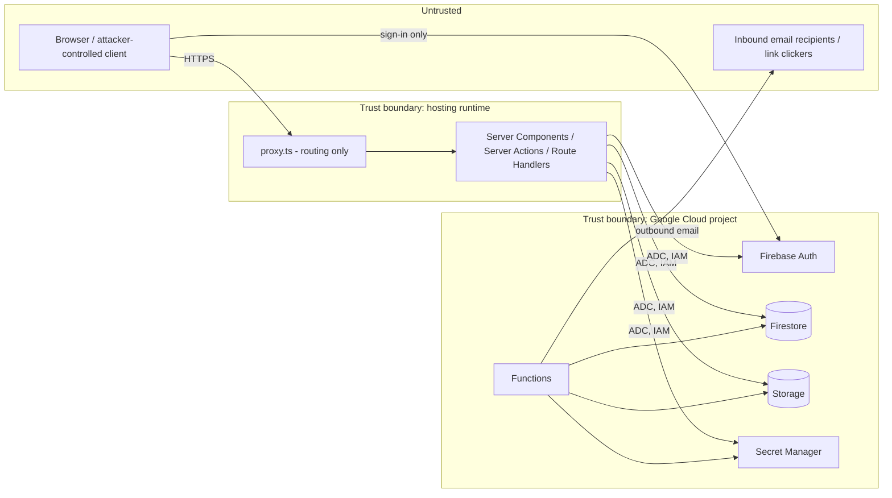

# 04 — Security and Compliance

> **Prev:** [03 Database Schema](03-database-schema.md) · **Next:** [05 White-Label & Multi-Tenancy](05-white-label-and-multi-tenancy.md)
> This plan reduces risk; it does not make the system "secure" in an absolute sense. Residual risk is tracked in [00 §10](00-project-overview.md#10-risks) and re-assessed before each release.

## Contents

1. [Security principles](#1-security-principles)
2. [Assets, actors, trust boundaries](#2-assets-actors-trust-boundaries)
3. [Threat model (STRIDE)](#3-threat-model-stride)
4. [Authentication and session management](#4-authentication-and-session-management)
5. [Authorization model](#5-authorization-model)
6. [Firebase Admin SDK and service accounts](#6-firebase-admin-sdk-and-service-accounts)
7. [Firestore and Storage Security Rules](#7-firestore-and-storage-security-rules)
8. [Input validation, output encoding, injection, XSS, CSRF, SSRF](#8-input-validation-output-encoding-injection-xss-csrf-ssrf)
9. [Rate limiting and abuse prevention](#9-rate-limiting-and-abuse-prevention)
10. [Secure headers and CSP](#10-secure-headers-and-csp)
11. [Secrets management and encryption](#11-secrets-management-and-encryption)
12. [Audit logging and sensitive-data handling](#12-audit-logging-and-sensitive-data-handling)
13. [File upload security](#13-file-upload-security)
14. [Dependency scanning and security testing](#14-dependency-scanning-and-security-testing)
15. [Release-blocking vulnerabilities](#15-release-blocking-vulnerabilities)
16. [Privacy and compliance](#16-privacy-and-compliance)
17. [Security acceptance criteria](#17-security-acceptance-criteria)

---

## 1. Security principles

1. **Never trust the client** for tenant ID, role, permissions, ownership, prices, limits, or record IDs' ownership. Tenant comes from host + verified session + membership lookup on the server.
2. **Deny by default** — rules, permissions, routes, CORS, CSP.
3. **Single enforcement chokepoint** for mutations (`withTenantAction`) and reads (`requireTenantContext` + tenant repositories). Bypassing them is a lint error.
4. **Least privilege** for humans, service identities, and roles.
5. **Defense in depth** — isolation enforced at routing, session, context, repository, rules, caching, and tests ([02 §7](02-system-architecture.md#7-multi-tenant-isolation-strategy)).
6. **Secure defaults for agents** — security-relevant files are protected; changes need Security agent + human approval ([08 §8](08-ai-agentic-development-workflow.md#8-guardrails-protected-areas-and-prohibited-actions)).
7. **No security through obscurity** — 404 for cross-tenant to avoid existence oracles, but correctness never depends on hidden IDs.

## 2. Assets, actors, trust boundaries

| Asset | Sensitivity |
|-------|------------|
| Tenant CRM data (contacts' PII, deal values, notes) | High — personal + commercial |
| User accounts, sessions, invitation/handoff tokens | High |
| Tenant branding & configuration | Low–Medium (branding is public on login page) |
| Audit logs (IP, UA) | Medium–High |
| Service identities, secrets (email API key, rate-limit token, cursor HMAC key) | Critical |
| Backups/exports | High |



Attackers considered: anonymous internet user; authenticated user of tenant A attacking tenant B; low-privilege member escalating within tenant; malicious tenant admin (phishing via branding/emails, abuse of import/export); compromised dependency; compromised developer/agent account; curious operator staff.

## 3. Threat model (STRIDE)

| # | Threat | Category | Scenario | Mitigations | Tests | Residual |
|---|--------|----------|----------|-------------|-------|----------|
| T1 | Cross-tenant IDOR | Info disclosure | User of A requests `/contacts/{idFromB}` or passes B's `companyId` in a form | Tenant-scoped repositories; path from ctx; `tenantId` field check; 404 | TC-SEC-001, TC-SEC-012 | Low |
| T2 | Forged tenant/role in payload | Elevation | Server Action payload includes `tenantId`/`role` | Strict schemas reject unknown keys; ctx-only tenant; role from membership doc | TC-SEC-002, TC-SEC-004 | Low |
| T3 | Server Action called directly | Elevation | Attacker POSTs to action ID without UI | Wrapper enforces authn/authz/validation for every action; lint ensures every exported action is wrapped | TC-SEC-004 | Low |
| T4 | Session theft | Spoofing | XSS reads tokens; cookie sent cross-site | httpOnly cookie; no refresh token persisted client-side; CSP; SameSite=Lax; short lifetime; revocation | TC-AUTH-004, TC-SEC-010 | Med |
| T5 | Credential stuffing / brute force | Spoofing | Repeated login attempts | Firebase Auth built-in protections; session-creation rate limit by IP/email-hash; no public signup surface; invitation acceptance rate-limited | TC-SEC-007 | Med |
| T6 | Invitation token abuse | Spoofing | Guessing, replaying, or forwarding invite | 256-bit tokens, hash at rest, expiry, single-use, email must match | TC-RBAC-001 | Low |
| T7 | Privilege escalation in tenant | Elevation | Admin promotes self to owner; member edits others' deals | Role-change rules (FR-RBAC-003), record-level checks | TC-RBAC-003, TC-RBAC-004 | Low |
| T8 | Stored XSS via notes, names, branding | Tampering | `` in contact name or activity body | React escaping; Markdown rendered with sanitizer and no raw HTML; CSP nonces; no SVG uploads | TC-SEC-010 | Low |
| T9 | CSV formula injection | Tampering | Exported cell `=HYPERLINK(...)` | Prefix dangerous leading chars | TC-IMP-002 | Low |
| T10 | Phishing via branded emails | Spoofing | Malicious tenant crafts look-alike emails | No tenant HTML/links; fixed templates; abuse reporting; suspension | TC-BRAND-003 | Med |
| T11 | CDN/cache cross-tenant leakage | Info disclosure | Authenticated page cached and served to another tenant | `private, no-store`; no shared caches for tenant data | TC-SEC-013 | Low |
| T12 | Admin SDK credential leak | Elevation | JSON key committed or exposed | No keys (ADC); secret scanning; org policy disabling key creation | TC-SEC-008 | Low |
| T13 | Malicious upload | Tampering | Polyglot image, decompression bomb, CSV bomb | Magic-byte check, size/dimension limits, re-encode, row/cell limits, isolated bucket | TC-BRAND-001, TC-IMP-001 | Low |
| T14 | DoS / cost exhaustion | DoS | Search spam, giant imports/exports, signup floods | Rate limits; plan limits; max instances; budget alerts | TC-SEC-007, TC-COST-001 | Med |
| T15 | Audit tampering / repudiation | Repudiation | Admin deletes audit entries | No update/delete paths; rules deny; retention TTL only | TC-AUD-003 | Low |
| T16 | Supply-chain compromise | Tampering | Malicious npm package | Lockfile, `pnpm audit`, Dependabot/Renovate, minimal deps, provenance checks, review of new deps | TC-SEC-009 | Med |
| T17 | Host header poisoning | Spoofing | Password-reset link built from attacker host | Allowlisted hosts; links built from stored domain records | TC-TEN-004 | Low |
| T18 | Tenant enumeration | Info disclosure | Probing subdomains/custom domains, workspace finder | Neutral 404; slug checks only inside authenticated consoles; finder answers by email only; wildcard TLS cert (no per-tenant CT log entries) | TC-TEN-004, TC-SEC-007 | Low–Med (custom domains are public by nature) |
| T19 | Operator insider access | Info disclosure | Support staff reads tenant data | Console has no CRM read paths (A-09); IAM restricted; Data Access audit logs enabled in prod | Review | Med |
| T20 | Agent-introduced regression | Tampering | AI agent loosens rules or removes check | Protected files, CODEOWNERS, security review, isolation tests in CI | CI gates | Med |
| T21 | Payment webhook forgery / replay | Spoofing, Elevation | Attacker posts fake "payment captured" event or replays an old one to unlock a plan | Per-agency signature verification over raw body, event-ID idempotency, state re-fetched from gateway API, amounts never trusted from payload | TC-BILL-003 | Low |
| T22 | **Privileged account takeover (no MFA)** | Spoofing | Phished platform/agency admin password → mass workspace suspension, domain hijack, gateway credential swap | FR-AUTH-008: Google Workspace sign-in with org-enforced 2SV for platform staff, short sessions, re-auth for sensitive ops, login alerts with one-click revoke, privileged rate limits, optional IP allowlist; MFA when Identity Platform adopted | TC-AUTH-007 | **Med–High (accepted by owner until MFA)** |
| T23 | Cross-agency access | Info disclosure, Elevation | Agency A admin references agency B workspace/domain/price in console actions | `AgencyContext` from staff record; agency-scoped repositories; 404 | TC-AGY-003 | Low |
| T24 | Agency staff reading client CRM data | Info disclosure | Agency admin uses console to read contacts | Types prevent `AgencyContext` building `TenantContext`; CRM access only via visible, audited membership (OQ-21) | TC-AGY-002 | Low |
| T25 | Member reading colleagues' records | Info disclosure | Member edits URL/ID, uses search, reports, export, or kanban to see others' records | Repository-enforced own scope (ADR-023) on every read path | TC-RBAC-004 | Low |
| T26 | Custom domain takeover / misrouting | Spoofing | Dangling DNS after domain removal, or attacker claims a domain mapped to another workspace | Vercel ownership verification (TXT) before activation; one host ↔ one workspace; removal detaches from Vercel and authorized domains; periodic dangling-domain check | TC-TEN-008 | Low |
| T27 | Gateway credential leak or swap | Tampering, Info disclosure | Agency gateway keys read from DB/logs, or swapped to attacker's account to divert payments | Keys only in Secret Manager (refs in Firestore), masked in UI, change requires agency_owner + re-auth + email alert to agency owner and platform | TC-BILL-001, TC-AUTH-007 | Low–Med |
| T28 | Orphan account creation | Spoofing | Attacker creates Firebase accounts via REST API | No membership → no access; orphan cleanup job; Auth API key restricted by referrer | TC-AUTH-001 | Low |

Threat model is reviewed at Phase 9 (T-09-01) and whenever an ADR changes.

## 4. Authentication and session management

Flow and pseudocode: [02 §4](02-system-architecture.md#4-firebase-authentication-integration).

| Control | Requirement |
|---------|------------|
| Password policy | ≥ 12 chars, ≤ 128; Firebase password policy enforcement enabled **(verify Identity Platform password policy feature)**; no composition rules beyond length |
| Email enumeration protection | Enable Firebase "email enumeration protection" **(verify availability)**; generic UI messages |
| Session cookie | HttpOnly, Secure, SameSite=Lax, Path=/, host-only, ≤ 14 days (default 5); name `__Host-session` (Vercel imposes no cookie-name restriction — verify T-02-02) |
| Account creation | Server-side only during invitation acceptance (Admin `createUser`); client SDK never creates users (FR-AUTH-001) |
| Freshness | Session creation requires `auth_time` ≤ 5 min; sensitive operations require re-auth ≤ 5 min (`REAUTH_REQUIRED`) |
| Revocation | `verifySessionCookie(..., checkRevoked=true)`; `revokeRefreshTokens(uid)` on sign-out, password reset, removal (if no other memberships), forced sign-out |
| Client storage | Firebase client persistence `NONE`/in-memory; no tokens in `localStorage` |
| MFA | **Deferred** ([CONFIRMED], OQ-10; FR-AUTH-005 P3). Compensating controls FR-AUTH-008 below. Residual risk R-15 accepted by owner; re-evaluate before onboarding the second agency or any regulated client. |
| Platform staff sign-in | Google sign-in only; server verifies email domain ∈ `APP_PLATFORM_STAFF_DOMAINS` and `email_verified`; operator enforces 2-Step Verification in Google Workspace admin (evidence in release checklist) |
| Agency staff sign-in | Google (domain allowlist per agency, optional) or email/password; stricter rate limits |
| Console sessions | Separate hosts (`console.`, `partners.`), separate cookies; max 8 h (platform) / 12 h (agency); re-auth ≤ 5 min for sensitive operations |
| Login alerts | Email on new device/IP for privileged accounts with "not me" link → `revokeRefreshTokens` + session purge (FR-AUTH-008) |
| Account linking | One account per email; Google + password linking only after verified email |

## 5. Authorization model

### 5.1 Layers
1. **Tenant membership** — `requireTenantContext()` (session → host tenant → tenant active → membership active).
2. **Permission (RBAC)** — `authorize(ctx, permission)` using `ROLE_PERMISSIONS` from `packages/shared/permissions.ts` (matrix in [01 §4.3](01-product-requirements.md#43-permission-matrix)).
3. **Record-level** — services check ownership for `own`-scoped permissions.
4. **Entitlements** — `assertEntitlement(ctx, 'features.import')`, `assertWithinLimit(ctx, 'records', +n)`.

```ts
// PSEUDOCODE — packages/core/authz.ts
export function authorize(ctx: TenantContext, p: Permission): void {
  if (!ROLE_PERMISSIONS[ctx.role].has(p)) {
    audit.securityEvent(ctx, 'authz.denied', { permission: p })   // rate-limited logging
    throw new ForbiddenError(p)
  }
}
export function canMutateRecord(ctx: TenantContext, rec: { ownerUid: string }, p: 'record.update'|'record.delete') {
  if (ROLE_SCOPE[ctx.role][p] === 'all') return true
  if (ROLE_SCOPE[ctx.role][p] === 'own') return rec.ownerUid === ctx.uid
  return false
}
// Role-change guard (FR-RBAC-003)
export function assertCanChangeRole(actor: TenantContext, target: Member, newRole: Role) {
  if (target.uid === actor.uid) throw new ForbiddenError('self_role_change')
  if (newRole === 'owner') throw new ForbiddenError('use_transfer_ownership')
  if (target.role === 'owner') throw new ForbiddenError('owner_immutable')
  if (actor.role === 'admin' && (newRole === 'admin' || target.role === 'admin')) throw new ForbiddenError()
  if (!['owner','admin'].includes(actor.role)) throw new ForbiddenError()
}
```

### 5.2 Tenant isolation rules for developers/agents
- Never accept `tenantId` from request bodies, query strings, cookies other than the session, or headers other than `Host`.
- Never call `db.collection('tenants').doc(x)` outside `packages/core/repositories`.
- Collection-group queries are allowed only in Functions (system jobs) or with a mandatory `where('tenantId','==',ctx.tenantId)` reviewed by the Security agent.
- Every new Server Action/Route Handler requires an isolation test (cross-tenant + lower-role) in the same PR.
- Return `NOT_FOUND` for records outside the tenant.

### 5.3 Platform and agency authorization
- `requirePlatformContext()` on `console.example.com`: valid console session, Google provider, allowlisted email domain, `platformAdmins/{uid}` doc + role. Platform actions never read CRM collections (A-09).
- `requireAgencyContext()` on `partners.example.com`: valid partners session + `agencies/{agencyId}/staff/{uid}` active + agency status active; `agencyId` comes from the staff record (if a user staffs several agencies, an explicit agency switcher selects among *their* staff records). Agency actions read only tenant root docs where `agencyId == ctx.agencyId`.
- Agency staff who need CRM access are invited into the workspace as normal members (visible to the workspace owner, flagged `viaAgencyStaff`, audited) — OQ-21.

### 5.4 Member own-only scope
Members' reads are constrained in the repository layer (ADR-023): `scopedQuery` adds `ownerUid == uid`; `getById` returns NotFound for others' records; aggregations (dashboards, reports), search, exports, kanban, and notifications use the same scoped builders. Related-record labels come from denormalized snapshots, never by loading the related document for Members.

## 6. Firebase Admin SDK and service accounts

| Principal | Used by | IAM roles (least privilege; refine in T-01-09) |
|-----------|---------|------------------------------------------------|
| Web runtime SA (impersonated from Vercel via Workload Identity Federation) | `apps/web` on Vercel | `roles/datastore.user`, `roles/firebaseauth.admin` (session cookies, revoke, user mgmt), `roles/storage.objectAdmin` on specific buckets only, `roles/secretmanager.secretAccessor` on specific secrets, `roles/iam.serviceAccountTokenCreator` on itself only if signed URLs require it (verify) |
| Console runtime SA (via WIF) | `apps/console` on Vercel | Same Auth/Datastore roles; Secret Manager **admin on `agy_*` gateway secrets only** (create/rotate per agency); no Storage on private import/export bucket |
| Functions runtime SA | `functions/` | `roles/datastore.user`, Storage object admin on buckets, Secret accessor for email key and `agy_*` gateway secrets (reconciliation) |
| CI deployer (Workload Identity Federation from GitHub) | GitHub Actions | `roles/firebaserules.admin`, `roles/datastore.indexAdmin`, `roles/cloudfunctions.developer`; **no** data roles. Vercel deploys use a Vercel token stored as a GitHub secret (scoped to the team/projects) |

**Vercel → GCP federation:** a Workload Identity Pool provider trusts Vercel's OIDC issuer for the specific team/project/environment claims; each environment (preview, production) maps to a different service account; preview deployments get **dev-project** access only **(verify claim names and setup in T-01-09)**.
| Humans | Engineers | Staging: editor-ish; Production: viewer by default; time-bound elevation (break-glass) audited |

Controls:
- Org policy `iam.disableServiceAccountKeyCreation` on staging/prod projects **(verify org availability)**.
- Admin SDK modules start with `import 'server-only'` to make client import a build error.
- Separate service accounts per deployable (blast-radius reduction).
- Cloud Audit Logs: Admin Activity (default) + Data Access logs for Firestore in production (cost review).

## 7. Firestore and Storage Security Rules

**Specification** (implemented in T-03-03; tests in [09 §6](09-testing-and-quality-assurance.md#6-firestore-and-storage-security-rules-tests)):

```
// firestore.rules — SPEC (MVP, ADR-003): client SDK has no data access
rules_version = '2';
service cloud.firestore {
  match /databases/{database}/documents {
    match /{document=**} {
      allow read, write: if false;
    }
  }
}
// storage.rules — SPEC: deny all client access; brand assets served via public bucket/CDN configured with IAM, not rules
```

- Brand assets: separate bucket `<project>-brand-assets` with public read via IAM (`allUsers: objectViewer`) **only** for that bucket, objects written exclusively by server after validation; content-hash names; no listing permission.
- Private bucket (imports, exports, DSAR files): no public access; uniform bucket-level access; downloads only via short-lived V4 signed URLs (≤ 15 min) issued after authorization; lifecycle delete after 7 days.
- If a future ADR enables client reads (real-time), rules must re-implement membership checks using `get()`/`exists()` on `tenants/{t}/members/{request.auth.uid}` with full emulator tests before enabling — a Security-agent + human checkpoint.

## 8. Input validation, output encoding, injection, XSS, CSRF, SSRF

| Concern | Control |
|---------|---------|
| Validation | Shared Zod schemas; `.strict()` on server; length limits on every string; enums allowlisted; IDs regex-checked; Unicode NFC normalization; reject control chars |
| Mass assignment | Explicit DTO → document mapping; protected fields (`tenantId`, `ownerUid`, `createdBy`, `isDeleted`, `status=converted`, counts) never copied from input |
| Field-path injection | Sort/filter fields chosen from allowlisted query shape IDs, never raw strings |
| Prototype pollution | Schemas strip `__proto__`/`constructor`; no deep-merge of user objects |
| XSS | React auto-escaping; prohibit `dangerouslySetInnerHTML` (lint) except in sanitizer-wrapped `SafeMarkdown` component (allowlist: p, strong, em, ul, ol, li, code, pre, a[href^=https|mailto], br) with `rel="noopener noreferrer nofollow"` and `target=_blank`; CSP nonces |
| URL fields | Only `http/https`; rendered with `rel` attributes; never `javascript:` |
| Email templates | Logic-less template engine with HTML escaping; tenant text plain only |
| Log injection | Structured JSON logging (no string concatenation of user input) |
| CSV injection | Export prefixing (FR-RPT-002) |
| CSRF | **As implemented (Phase 2):** Server Actions — Next.js rejects a mismatched `Origin` but lets requests *without* an Origin through, so the action wrappers additionally require a present, same-host `Origin`. Session route handlers — same Origin check plus a required custom header `X-CRM-Request: 1` (forces a CORS preflight that is never allowed), replacing the planned double-submit token. SameSite=Lax cookies; no state change on GET except the single-use, token-authorized "not me" revocation link |
| CORS | No CORS headers (same-origin only) |
| SSRF | Server never fetches user-supplied URLs in MVP (no link previews, no logo-by-URL, no webhooks). Future webhook/URL fetch features require an SSRF guard (DNS resolution allowlist, block private/link-local/metadata IPs, no redirects) |
| Open redirect | `next`/`returnTo` params must be relative paths matching `^/[A-Za-z0-9/_-]*$` |
| Clickjacking | `frame-ancestors 'none'` |
| NoSQL/regex DoS | No user-supplied regex; bounded token lengths |

## 9. Rate limiting and abuse prevention

| Endpoint / action | Key | Limit (initial; tune with data) | On store failure |
|-------------------|-----|------------------|------------------|
| `POST /api/auth/session` | IP; email-hash | 10/min/IP; 20/hour/email | fail-closed |
| Privileged sign-in (console/partners) | IP; email-hash | 5/min/IP; 10/hour/email; lockout notice after 10 failures | fail-closed |
| Invitation acceptance / account creation | IP; token-hash | 10/hour/IP; 5 attempts/token | fail-closed |
| Workspace/agency provisioning, domain add | uid | 30/hour | fail-closed |
| Payment webhooks | provider+agencyId | 300/min (bursts allowed; signature check first) | fail-open (signature still required) |
| Checkout session creation | tenant | 10/hour | fail-closed |
| Password reset / verification resend | IP; email-hash | 5/hour | fail-closed |
| Invite create/resend | tenant; uid | 50/day/tenant; 3 resends/invite | fail-closed |
| Global search | uid | 60/min | fail-open + alert |
| Mutations (generic) | uid | 120/min | fail-open + alert |
| Import / export / tenant export | tenant | 5/hour import; 10/hour export; 1/day full export | fail-closed |
| Test email send | tenant | 10/day | fail-closed |
| Workspace finder | IP; email-hash | 3/hour | fail-closed |

Abuse controls: email verification before workspace creation; disposable-domain heuristics (P2); platform kill-switch (suspend tenant) with immediate effect ≤ 60 s; monitoring for spikes in invites/emails per tenant; optional Firebase App Check / reCAPTCHA Enterprise on public forms (P2, **verify** compatibility with session flow).

## 10. Secure headers and CSP

Set in `next.config` headers and/or proxy (nonce):

| Header | Value |
|--------|-------|
| `Content-Security-Policy` (app) | `default-src 'self'; script-src 'self' 'nonce-{n}' 'strict-dynamic'; style-src 'self' 'unsafe-inline'` (tighten if feasible); `img-src 'self' https://assets.example.com data: blob:; connect-src 'self' https://identitytoolkit.googleapis.com https://securetoken.googleapis.com; frame-src https://<auth-domain> (Google sign-in); frame-ancestors 'none'; base-uri 'none'; form-action 'self'; object-src 'none'; upgrade-insecure-requests` |
| CSP (marketing static pages) | Hash- or nonce-based; nonce forces dynamic rendering — decide per page group in T-03-09 **(verify Next 16 SRI/nonce support)** |
| `Strict-Transport-Security` | `max-age=63072000; includeSubDomains; preload` (after confirming all subdomains HTTPS) |
| `X-Content-Type-Options` | `nosniff` |
| `Referrer-Policy` | `strict-origin-when-cross-origin` (app: `same-origin`) |
| `Permissions-Policy` | `camera=(), microphone=(), geolocation=(), payment=(), usb=()` |
| `Cross-Origin-Opener-Policy` | `same-origin-allow-popups` (Google popup sign-in) — verify |
| Gateway redirects | Checkout uses server-issued redirects to gateway-hosted pages; if any gateway flow requires a form post or embedded script, add only that gateway origin to `form-action`/`script-src`/`frame-src` (verify per gateway in T-06-11) |
| `X-Robots-Tag` | `noindex, nofollow` on tenant and console hosts ([07](07-seo-aeo-and-performance.md)) |
| `Cache-Control` | `private, no-store` on authenticated responses |

## 11. Secrets management and encryption

- Platform secrets: Vercel encrypted (sensitive) environment variables per environment, or fetched from **Google Secret Manager** at runtime via federation; Functions use `defineSecret`. GitHub Actions uses WIF (no long-lived cloud keys) and GitHub encrypted secrets only for non-GCP tokens (e.g., Vercel deploy token).
- **Per-agency gateway secrets** (API key ID/secret, webhook secret): created by the console server in Secret Manager as `agy_{agencyId}-{provider}-{kind}`; Firestore stores only the resource name; write-only UI (never displayed again); in-memory cache ≤ 5 min; rotation by adding a new version; every change audited and alerted (T27).
- **PCI scope:** hosted checkout/approval pages only (Razorpay Checkout/Subscriptions, PayPal approval, Stripe Checkout); our servers never receive PAN/CVV/bank credentials — target PCI DSS SAQ-A eligibility for agencies (confirm with each gateway/QSA). CSP `frame-src`/`script-src` adjusted only if a gateway's embedded script is used (prefer redirect).
- Firebase web config (`apiKey`, `authDomain`, `projectId`, `appId`) is **public by design**; protected by Auth settings, authorized domains, and API key restrictions (HTTP referrer + API restrictions) — not a secret.
- Secrets inventory: `GCP_WIF_*` config (non-secret) or `FIREBASE_CLIENT_EMAIL` + `FIREBASE_PRIVATE_KEY` (local dev / fallback only), `EMAIL_PROVIDER_API_KEY`, `RATE_LIMIT_REDIS_URL`/`TOKEN`, `CURSOR_SIGNING_SECRET`, `UNSUBSCRIBE_SIGNING_SECRET`, `CSRF_SECRET`, `SENTRY_DSN` (low sensitivity). Rotation every 180 days or on suspicion; HMAC secrets support two active versions during rotation.
- CI checks: gitleaks (or GitHub secret scanning + push protection) on every PR; build-output scan ensuring no server env names appear in client chunks.
- Encryption in transit: TLS 1.2+ (Google-managed certs), HSTS. At rest: Google default encryption for Firestore/Storage/backups. CMEK for Firestore is an Enterprise option **(verify availability/location)** — P3.
- No field-level encryption in MVP (A-10); sensitive categories prohibited by Terms.

## 12. Audit logging and sensitive-data handling

- Tenant audit events per FR-AUD-001; platform events in `platformAuditLogs`.
- Security events (authz denied bursts, rate-limit hits, session revocations, rule-denied attempts from Cloud Audit Logs) emitted as structured logs with log-based metrics and alerts.
- PII classification: **High** (contact email/phone/address/notes), **Medium** (names, job titles, IP), **Low** (IDs, enums). Logs contain Low only (+ IP in audit docs).
- Exports and DSAR files: private bucket, signed URLs, 7-day lifecycle, audited download issuance.
- Error tracking configured to scrub request bodies, cookies, headers (`Authorization`, `Cookie`), and query strings.

## 13. File upload security

| Upload | Allowed | Limits | Processing |
|--------|---------|--------|-----------|
| Logo / favicon / avatar | PNG, JPEG, WebP (magic bytes + `sharp` decode), **no SVG/GIF** | ≤ 1 MB (favicon 256 KB, avatar 512 KB), ≤ 2048×2048, decoded pixel limit ≤ 16 MP | Re-encode to WebP/PNG, strip metadata, content-hash filename, `Content-Type` set by server, `Content-Disposition: inline`, served from `assets.example.com` (separate origin) |
| CSV import | `.csv` text/csv or text/plain; UTF-8 | ≤ 10 MB, ≤ 10,000 rows, ≤ 50 columns, ≤ 10,000 chars/cell | Stream parse in Function; reject binary content; no formula evaluation; stored in private bucket; deleted after 7 days |

Uploads pass through Server Actions/Route Handlers (body size limit configured explicitly, **verify** Next 16 `serverActions.bodySizeLimit`). Malware scanning is not required for images that are re-encoded; CSVs are parsed as text only. Virus scanning for arbitrary attachments becomes mandatory if attachments are added (P3).

## 14. Dependency scanning and security testing

| Activity | Tool (proposed) | Cadence | Gate |
|----------|-----------------|---------|------|
| Dependency audit | `pnpm audit --prod` + GitHub Dependabot alerts / Renovate | Every PR + daily | Block on Critical/High with fix available |
| SAST | CodeQL (JS/TS) + ESLint security plugins (`eslint-plugin-security`, custom rules) | Every PR | Block on High |
| Secret scanning | gitleaks / GitHub push protection | Every push | Block |
| Rules tests | `@firebase/rules-unit-testing` on emulator | Every PR | Block |
| Isolation & authz tests | Vitest integration + Playwright | Every PR | Block |
| DAST | OWASP ZAP baseline against staging | Nightly + pre-release | Block on High |
| License check | `license-checker` allowlist | Weekly | Warn |
| SBOM | CycloneDX generation at release | Release | Archive |
| Manual review | Security agent + human for protected files | Per PR touching them | Block |
| External pentest | Third party | Before GA (recommended) | Critical/High fixed |

Remediation SLAs: Critical 48 h · High 7 d · Medium 30 d · Low 90 d (or accepted with rationale).

## 15. Release-blocking vulnerabilities

Any of the following blocks a production release ([13](13-release-readiness-checklist.md#8-explicit-blockers)):

1. Any cross-tenant read/write/inference path (failing TC-SEC-001/012/013/015 or pentest finding).
2. Any privilege escalation (failing TC-SEC-004, TC-RBAC-002/003/004).
3. Any Server Action or Route Handler not wrapped by authn/authz (lint rule violation or audit finding).
4. Firestore/Storage rules allowing client access not approved by ADR (failing TC-SEC-003).
5. Stored/reflected XSS or CSP missing on app routes.
6. Secrets in repo, image, logs, or client bundle.
7. Critical/High dependency vulnerability in production deps without approved exception.
8. Authenticated responses cacheable by shared caches.
9. Session cookie missing HttpOnly/Secure, or revocation not enforced.
10. Platform or agency console reachable without FR-AUTH-008 controls (domain-restricted Google sign-in for platform staff with Workspace 2SV enforced, short sessions, re-auth, login alerts) — TC-AUTH-007.
11. Audit log mutable via application paths.
12. Private pages indexable (failing TC-SEO-001).
13. Backups/PITR not enabled in production.
14. Any payment webhook path that changes entitlements without verified signature + gateway re-fetch (TC-BILL-003), or any card/bank data reaching our servers/logs (TC-SEC-016).
15. Any cross-agency access path (TC-AGY-003) or agency-context access to CRM records (TC-AGY-002).
16. Member able to read another user's record through any path (TC-RBAC-004).
17. A custom domain routable before ownership verification (TC-TEN-008).

## 16. Privacy and compliance

**Roles:** For workspace CRM data the client business (workspace) is the **controller**, the agency is its **processor**, and the operator is the agency's **sub-processor**. For user accounts and operator marketing-site visitors the operator is a **controller**. Contract chain: operator ↔ agency DPA (with sub-processor list) and agency ↔ client DPA (template provided to agencies). (Legal review required; OQ-12.)

| Area | Plan |
|------|------|
| Legal docs | Privacy Policy, Terms, DPA template for tenants, subprocessor list (Google Cloud/Firebase, email provider, Redis provider, error tracking) |
| GDPR/UK GDPR | DSAR export/erasure tools (FR-PRIV-001/002); records of processing; data minimization; EU-region instance option (ADR-019); SCCs via vendor DPAs |
| India DPDP Act 2023 (Razorpay-primary clients likely in India) | Consent/notice handled by data fiduciary (workspace); breach notification support; erasure tools; region choice per instance (e.g., `asia-south1`) when required — legal review (R-17) |
| Payments | No card data stored (SAQ-A target); gateway DPAs; billing records retention per tax law (OQ-12) |
| CCPA/CPRA | Access/deletion tooling covers requirements; no sale of data |
| Consent/cookies | Marketing site: essential cookies only by default; analytics only after consent (if analytics used); app uses essential session cookie only |
| Retention | [03 §13](03-database-schema.md#13-retention-deletion-backups-recovery); backups expire ≤ 14 weeks; disclosed |
| Tenant offboarding | Full export (FR-TEN-007) then deletion (FR-TEN-006) |
| Breach notification | Incident runbook ([10 §11](10-ci-cd-and-deployment.md#11-incident-response)) supports 72-hour regulatory notification and processor → controller notice "without undue delay" |
| Children's data | Not directed at children; Terms prohibit |
| Special categories | Prohibited (A-10) |
| SOC 2 | Not in MVP; controls (access reviews, change management via PRs, logging) chosen to be compatible |

## 17. Security acceptance criteria

| ID | Criterion | Verified by |
|----|-----------|------------|
| SAC-01 | 100% of Server Actions use `withTenantAction` / `withUserAction` / `withAgencyAction` / `withPlatformAction`; 100% of mutating Route Handlers call `requireTenantContext` | Lint rule + TC-SEC-004 |
| SAC-02 | Cross-tenant suite covers every entity × (read, list, update, delete, reference) | TC-SEC-001, TC-SEC-012 |
| SAC-03 | Role × permission table test passes for all permissions | TC-RBAC-002 |
| SAC-04 | Rules deny all client reads/writes for every collection path in the tree | TC-SEC-003 |
| SAC-05 | Security headers present on all app routes; CSP without `unsafe-eval` | TC-SEC-006 |
| SAC-06 | Rate limits return 429 with `Retry-After` | TC-SEC-007 |
| SAC-07 | No secrets detected in repo or bundles | TC-SEC-008 |
| SAC-08 | No Critical/High prod dependency vulnerabilities | TC-SEC-009 |
| SAC-09 | XSS payload corpus inert across all text inputs and branding | TC-SEC-010 |
| SAC-10 | Cross-origin POST to state-changing handlers rejected | TC-SEC-011 |
| SAC-11 | Authenticated responses `private, no-store`; no cross-tenant cache hits | TC-SEC-013 |
| SAC-12 | Suspended/deleted tenant sessions blocked ≤ 60 s | TC-SEC-015, TC-TEN-002 |
| SAC-13 | ZAP baseline: no High alerts | T-09-03 |
| SAC-14 | Webhooks: invalid signature/replay/forged amount never change state | TC-BILL-003 |
| SAC-15 | Agency isolation and no agency CRM access | TC-AGY-002, TC-AGY-003 |
| SAC-16 | Privileged-account controls active (FR-AUTH-008) | TC-AUTH-007 |
| SAC-17 | Member own-scope enforced on every read path | TC-RBAC-004 |
| SAC-18 | No card/bank data in requests, storage, or logs | TC-SEC-016 |
