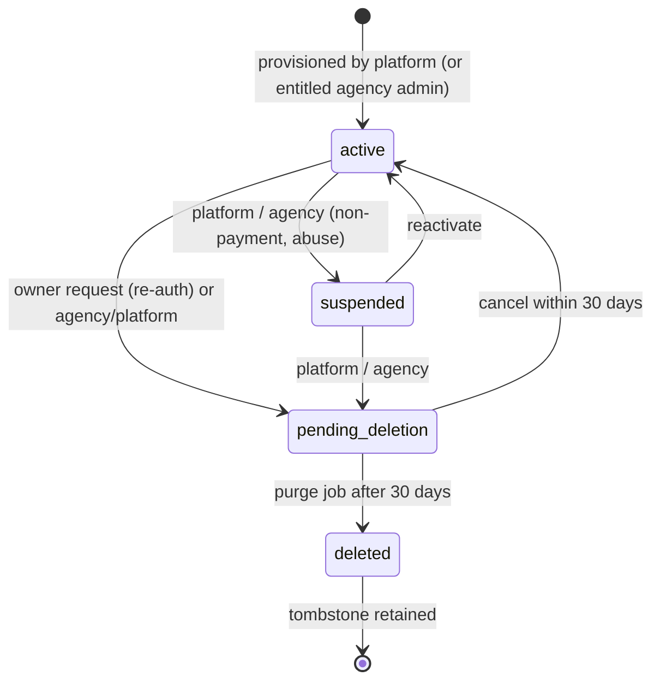
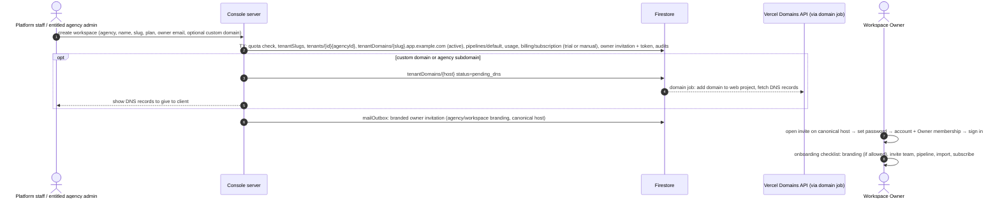

# 05 — White-Label and Multi-Tenancy

> **Prev:** [04 Security](04-security-and-compliance.md) · **Next:** [06 UI/UX](06-ui-ux-and-responsive-design.md)
> v1.1 — revised for owner answers: agencies resell to clients; workspaces created by the operator; custom domains at launch; payment gateways per agency; Vercel hosting; per-client deployments (instances).
> Isolation mechanics: [02 §7](02-system-architecture.md#7-multi-tenant-isolation-strategy), [04 §5](04-security-and-compliance.md#5-authorization-model). This document covers hierarchy, lifecycle, provisioning, branding, domains, configuration, billing linkage, and isolation tests.

## Contents

1. [Tenancy model](#1-tenancy-model)
2. [Lifecycle states](#2-lifecycle-states)
3. [Tenant onboarding and provisioning](#3-tenant-onboarding-and-provisioning)
4. [Branding and configuration](#4-branding-and-configuration)
5. [Domains and routing](#5-domains-and-routing)
6. [Tenant-aware authentication, queries, and caching](#6-tenant-aware-authentication-queries-and-caching)
7. [Email configuration and templates](#7-email-configuration-and-templates)
8. [Feature flags, plan limits, and configuration inheritance](#8-feature-flags-plan-limits-and-configuration-inheritance)
9. [Suspension, deletion, and export](#9-suspension-deletion-and-export)
10. [Cross-tenant isolation tests](#10-cross-tenant-isolation-tests)

---

## 1. Tenancy model

```mermaid
flowchart TD
  OP[Operator] --> I1[Instance: shared-us\nFirebase project + Vercel projects + region]
  OP --> I2[Instance: dedicated-xyz\n(other region, on demand)]
  I1 --> A1[Agency One\nbrand, domain, gateway]
  I1 --> A2[Agency Two]
  A1 --> W1[Workspace: Acme\ncrm.acme.example]
  A1 --> W2[Workspace: Globex\nglobex.crm.agency-one.example]
  A2 --> W3[Workspace: Initech\ninitech.app.example.com]
  W1 --> U1[Members: owner, admin, manager, member, viewer]
```

- **[CONFIRMED]** Agency → workspace hierarchy (OQ-13). **[PROPOSED]** Exactly two levels; no sub-agencies (A-01).
- **[PROPOSED]** Pooled model inside an instance (ADR-004); many instances possible (ADR-019, A-12). An agency lives in exactly one instance; data never crosses instances.
- A **user** is global within an instance (one Firebase Auth pool); **memberships** bind users to workspaces; **staff records** bind users to agencies; **platformAdmins** bind operator staff to the instance.

| Who | Can see | Cannot see |
|-----|---------|-----------|
| Platform staff | All agencies and workspace metadata in the instance | Workspace CRM records (A-09) |
| Agency staff | Their agency + metadata of their workspaces (status, plan, seats, usage, billing, domains) | Other agencies; any CRM records (unless invited as member) |
| Workspace Owner/Admin/Manager/Viewer | All records of their workspace | Agency internals, other workspaces |
| Workspace Member | **Only their own records** ([CONFIRMED]) | Others' records |

## 2. Lifecycle states



Agencies have the same states; an agency in `suspended`/`pending_deletion` forces all its workspaces to behave as suspended. Billing read-only (`billingState = read_only`) is **not** a lifecycle state: users can sign in and read/export, but cannot mutate (FR-BILL-002).

| State | Member access | Jobs | Login page | Data |
|-------|---------------|------|-----------|------|
| active | per role | run | branded | retained |
| active + billing read_only | read/export only; banner to pay | run (no imports) | branded | retained |
| suspended | blocked ("suspended" page) | skipped | branded + notice | retained |
| pending_deletion | blocked; owner can cancel & export | skipped (except export) | notice | retained |
| deleted | none | none | 404 | purged |

## 3. Tenant onboarding and provisioning

**[CONFIRMED]** No public signup; the operator creates workspaces during deployment/setup (OQ-02). Agency admins may provision only if the agency has `canProvisionWorkspaces` (OQ-22, default off).

### 3.1 Instance setup (once per instance)
1. Choose region (OQ-24) → create Firebase/GCP projects per environment ([12 §4](12-environment-and-configuration.md#4-firebase-setup)).
2. Create Vercel projects (`web`, `console`), pair function region, configure Vercel OIDC → GCP federation.
3. Register instance in `instances/<name>.json`; deploy rules, indexes, functions, apps from the release tag.
4. Bootstrap the first platform super admin via a one-time script (H8 approval), Google sign-in from the operator domain.

### 3.2 Agency onboarding (FR-AGY-001)

```mermaid
sequenceDiagram
  autonumber
  actor P as Platform staff (console.example.com)
  participant C as Console server (withPlatformAction, reauth)
  participant FS as Firestore
  participant SM as Secret Manager
  participant E as Email outbox
  actor AO as Agency Owner
  P->>C: create agency (name, slug, quotas, entitlements, billing mode)
  C->>FS: TX: agencySlugs/{slug}, agencies/{id}, staff invitation + token, platform audit
  C->>E: invitation email (operator-branded) → partners.example.com/invite/{token}
  AO->>C: accept invite → account created server-side → sign in
  AO->>C: agency branding defaults, base domain (optional), gateway credentials (agency_owner + reauth)
  C->>SM: create secrets agy_{id}-{provider}-* (values never returned)
  C->>FS: agencies/{id}.billing.secretRefs = resource names; audit + alert email
```

### 3.3 Workspace provisioning (FR-TEN-001)



### 3.4 Provisioning service pseudocode

```ts
// PSEUDOCODE — packages/core/services/tenants/provision.ts
async function provisionWorkspace(actor: PlatformContext | AgencyContext, input: ProvisionInput) {
  const agencyId = actor.kind === 'agency' ? actor.agencyId : input.agencyId     // agency staff cannot choose
  if (actor.kind === 'agency') assertAgencyEntitlement(actor, 'canProvisionWorkspaces')
  assertSlugSyntax(input.slug); assertNotReserved(input.slug)
  return db.runTransaction(async tx => {
    const prior = await tx.get(idempotencyDoc(actor.uid, input.idempotencyKey))
    if (prior.exists) return prior.data().result.tenantId
    const agency = await tx.get(db.doc(`agencies/${agencyId}`))
    if (!agency.exists || agency.get('status') !== 'active') throw new NotFoundError()
    if (agency.get('usage.workspaces') >= agency.get('quotas.maxWorkspaces')) throw new PlanLimitError('maxWorkspaces')
    const slugRef = db.doc(`tenantSlugs/${input.slug}`)
    if ((await tx.get(slugRef)).exists) throw new ConflictError('slug_taken')
    const tenantId = newId('tnt'); const platformHost = `${input.slug}.${APP_BASE_DOMAIN}`
    tx.create(slugRef, { tenantId, status: 'active', createdAt: now() })
    tx.create(db.doc(`tenants/${tenantId}`), defaultTenant({ ...input, agencyId, tenantId, canonicalHost: platformHost }))
    tx.create(db.doc(`tenantDomains/${platformHost}`), { tenantId, agencyId, type: 'platform_subdomain', status: 'active', isCanonical: true })
    tx.create(db.doc(`tenants/${tenantId}/pipelines/default`), DEFAULT_PIPELINE)
    tx.create(db.doc(`tenants/${tenantId}/usage/current`), { seats: 0, records: 0 })
    tx.create(db.doc(`tenants/${tenantId}/billing/subscription`), initialSubscription(input.planId, agency))
    createInvitationInTx(tx, { tenantId, email: input.ownerEmail, role: 'owner', host: platformHost })
    tx.update(agency.ref, { 'usage.workspaces': FieldValue.increment(1) })
    tx.set(idempotencyDoc(actor.uid, input.idempotencyKey), { result: { tenantId }, expireAt: inDays(1) })
    audit.inTx(tx, { agencyId, tenantId, actor, action: 'tenant.created' })
    return tenantId
  })
}
```

Default pipeline stages: Qualification (10%), Discovery (25%), Proposal (50%), Negotiation (75%), Won (100%), Lost (0%).

### 3.5 Onboarding acceptance
- Workspace usable as soon as the owner accepts the invite on the platform host; custom domain can activate later without downtime (redirect switch).
- Provisioning p95 ≤ 3 s (excluding domain verification).
- G-2 timing measured in UAT.

## 4. Branding and configuration

### 4.1 Theme derivation (FR-BRAND-002)

```ts
// PSEUDOCODE — packages/shared/branding/theme.ts
function deriveTheme(primary: Hex, accent: Hex): DerivedTheme | ContrastError {
  const primaryFg = bestOf(['#FFFFFF', '#111827'], c => contrast(c, primary))   // must be ≥ 4.5
  if (contrast(primaryFg, primary) < 4.5) return suggestAdjusted(primary)        // adjust OKLCH lightness
  const primaryOnSurface = adjustUntil(primary, c => contrast(c, SURFACE_LIGHT) >= 4.5)
  const primaryOnSurfaceDark = adjustUntil(primary, c => contrast(c, SURFACE_DARK) >= 4.5)
  const focusRing = adjustUntil(primary, c => contrast(c, SURFACE_LIGHT) >= 3)   // WCAG 1.4.11
  return { primary, primaryFg, primaryOnSurface, primaryOnSurfaceDark, focusRing, ...accentSame }
}
```

### 4.2 Inheritance (FR-AGY-004)

```mermaid
flowchart LR
  PD[Platform default brand] --> AB[Agency branding\nagencies/{a}.branding]
  AB --> WO[Workspace overrides\ntenants/{t}.branding\n(only if allowWorkspaceBranding)]
  WO --> R[brandingResolved\n(cached on tenant doc; recomputed by trigger)]
```

| Item | Agency level | Workspace level | Applied to |
|------|-------------|-----------------|-----------|
| App name | ✓ default (e.g., "OneCRM") | override (e.g., "Acme CRM") | titles, header, emails, login |
| Logos, favicon | ✓ | override | shell, login, emails |
| Colors (+ derived) | ✓ | override | CSS variables |
| Powered-by badge | per agency entitlement `removePoweredBy` | — | footer, emails |
| Sender domain (P2) | ✓ | — | emails |
| Settings (timezone, locale, currency…) | default for new workspaces | ✓ | formatting, reports |
| Email subject/intro overrides | ✓ defaults | override | transactional emails |

- Derived colors computed server-side on save; tenants/agencies cannot submit derived values.
- Root workspace layout injects `<style nonce>:root{--brand-primary:…}</style>` from regex-validated hex values only.
- `generateMetadata` on workspace hosts always sets `robots: { index: false, follow: false }`.

## 5. Domains and routing

**[CONFIRMED]** Custom domains at launch; subdomains supported.

| Host | Purpose | Status in MVP |
|------|---------|---------------|
| `www.example.com` (+ apex redirect) | Operator marketing & docs | ✓ |
| `console.example.com` | Platform console | ✓ |
| `partners.example.com` | Agency console (operator-branded, OQ-23) | ✓ |
| `{slug}.app.example.com` | Platform fallback host for every workspace | ✓ (wildcard on Vercel requires Vercel nameservers for `app.example.com` — verify) |
| `{slug}.crm.agency-one.example` | Agency-domain subdomain (FR-TEN-009) | ✓ (wildcard needs agency DNS delegated to Vercel; else per-subdomain records) |
| `crm.acme.example` | Workspace custom domain (FR-TEN-005) | ✓ |
| `assets.example.com` | Public brand assets | ✓ |
| `mail.example.com` / agency sender domains | Email | ✓ / P2 |

### 5.1 Custom domain onboarding (FR-TEN-005, ADR-022)
1. Agency/platform staff adds host to a workspace (re-auth) → `tenantDomains/{host}` `pending_dns` (uniqueness enforced by document ID).
2. Domain job calls Vercel Domains API to add the domain to the `web` project; stores returned verification/config records **(verify API endpoints, required records, and per-project domain limits for the chosen Vercel plan in T-01-09)**.
3. Console shows client-facing instructions (CNAME for subdomains; A/ALIAS for apex; TXT if the domain is already used on another Vercel account).
4. Job polls (every 10 min, ≤ 72 h) until Vercel reports verified + certificate issued → adds host to Firebase Auth authorized domains (R-02) → marks `active`; staff may set it canonical.
5. Canonical switch: `tenants/{t}.canonicalHost` updated; platform subdomain 301-redirects to canonical; invitation/reset links use canonical.
6. Removal: unset canonical (fallback to platform host) → remove from Vercel and authorized domains → delete mapping → audit. Dangling-DNS check reminds client to remove records.

### 5.2 Routing rules
- Server layout resolves `tenantDomains/{host}` (status `active`) → workspace; else neutral 404.
- Requests to `/_t/*` on any host are rejected (internal rewrite prefix).
- Session cookies are per host: changing the canonical host requires users to sign in once on the new host (communicated in the domain activation email).

## 6. Tenant-aware authentication, queries, and caching

| Concern | Rule |
|---------|------|
| Auth | One pool per instance; host-only session per workspace host; membership checked per request ([02 §6.1](02-system-architecture.md#61-server-action-wrapper)) |
| Account creation | Only through invitations (server-side `createUser`) |
| Login page | Resolved branding; never reveals whether an email is a member |
| Invitations | Link points to the workspace canonical host (or partners host for staff); acceptance verifies host ↔ invitation tenant |
| Queries | Scoped repositories; Members own-only (ADR-023) |
| Agency console | Metadata reads only ([03 §7](03-database-schema.md#7-access-patterns-and-tenant-ownership)) |
| Background jobs | IDs from document paths |
| Caching | Config caches keyed by IDs; authenticated responses `no-store` |
| Emails | Built from stored canonical host, never request host |
| Logs/metrics | `agencyId` + `tenantId` labels; per-agency and per-workspace usage dashboards |
| Files | `brand/{agencyId or tenantId}/…`, `imports/{tenantId}/…`, `exports/{tenantId}/…`; server validates prefixes |

## 7. Email configuration and templates

- Sender: operator domain `no-reply@mail.example.com` with display name = resolved app name; agency sender domain when verified (FR-BRAND-005, P2). SPF, DKIM, DMARC on all sending domains.
- Templates (code-owned; React Email or MJML — decide in T-05-03): workspace invitation, agency staff invitation, password reset, notification, digest (P2), export ready, ownership transferred, workspace/agency suspended, deletion scheduled/cancelled, **subscription events** (payment succeeded/failed, past due, read-only, cancelled), **domain activated/error**, **privileged login alert**, **gateway credentials changed**.
- Password-reset links generated with Admin SDK and sent via our provider with branding; continue URL on the canonical host (must be an authorized domain — R-02).
- Agency/workspace overrides limited to subject (≤ 120 chars) and intro (≤ 500 chars plain text) with allowlisted variables (FR-BRAND-003).
- Bounce/complaint webhooks → mark undeliverable; complaint spikes per agency/workspace → alert (R-13).

## 8. Feature flags, plan limits, and configuration inheritance

```mermaid
flowchart LR
  P[Platform defaults\nDEFAULT_CONFIG] --> PL[Plan template entitlements\nplans/{planId}]
  PL --> AG[Agency entitlements & quotas\nagencies/{a}.entitlements/quotas]
  AG --> TO[Workspace overrides\n(platform staff only)]
  TO --> BS[Billing state\n(active / past_due / read_only)]
  BS --> EFF[Effective config, resolved server-side per request]
```

```ts
// PSEUDOCODE
function resolveEffectiveConfig(tenant: Tenant, agency: Agency, plan: Plan): EffectiveConfig {
  const merged = deepMergeKnownKeys(DEFAULT_CONFIG, plan.entitlements, pickAgencyCaps(agency), tenant.entitlementOverrides)
  merged.flags = { ...DEFAULT_FLAGS, ...plan.flags, ...agency.flags, ...tenant.featureFlags }
  merged.whiteLabel.removePoweredBy = plan.entitlements.whiteLabel.removePoweredBy && agency.entitlements.removePoweredBy
  merged.readOnly = tenant.billingState === 'read_only'
  return EffectiveConfigSchema.parse(merged)
}
```

- Typed flags; unknown flags rejected. Limits checked in the same transaction as consuming writes. Agency quotas (`maxSeatsTotal`) checked across its workspaces at invite acceptance.
- Downgrade over limit: data retained; creates blocked; banner explains.
- Flag/entitlement changes audited; effective ≤ 60 s.
- Plan price/currency per agency lives in `agencies/{a}/planPrices` (FR-BILL-001) — entitlements never come from the gateway.

## 9. Suspension, deletion, and export

| Operation | Who | Steps | Audit |
|-----------|-----|-------|-------|
| Suspend workspace | Platform staff; agency staff (own workspaces) | status → suspended; email owner; sessions denied ≤ 60 s; jobs skip | agency + platform |
| Suspend agency | Platform staff | agency status → suspended → all workspaces behave suspended; partners console read-only notice | platform |
| Reactivate | Same as suspend | status → active | same |
| Request workspace deletion | Workspace Owner (re-auth, typed slug); agency/platform staff | pending_deletion 30 d; email admins + agency | tenant + agency |
| Purge workspace | Scheduled job | recursive delete `tenants/{id}`, storage prefixes, `tenantDomains` (incl. Vercel + authorized-domain removal), cancel gateway subscription, quarantine slug 90 d, update agency usage, revoke sessions for users with no remaining memberships/staff records, tombstone | platform |
| Delete agency | Platform staff (after all workspaces deleted or moved — move is P3) | purge agency subtree + secrets (Secret Manager versions destroyed) | platform |
| Full workspace export | Workspace Owner (and agency on owner's documented request — OQ-21) | job → JSON/CSV zip → signed URL 24 h → deleted 7 d | tenant |

## 10. Cross-tenant isolation tests

Fixtures: instance with agencies **Agency One** (workspaces **Acme** `crm.acme.example`, **Globex** `globex.crm.agency-one.example`) and **Agency Two** (workspace **Initech** `initech.app.example.com`). Each workspace has all five roles and ~50 records split across two Members (**Raj**, **Lena**). User **Sam** is viewer in Acme and admin in Globex; **Priya** is Agency One owner; **Tom** is Agency Two admin. Full catalog: [09 §5](09-testing-and-quality-assurance.md#5-multi-tenant-isolation-and-privilege-escalation-tests).

| Test | Attempt | Expected |
|------|---------|----------|
| TC-SEC-001 | Acme member requests Initech/Globex record IDs via URLs and every Server Action | 404 / `NOT_FOUND`; no data |
| TC-SEC-002 | Payload carries `tenantId`, `agencyId`, `ownerUid`, `role` | 400 `VALIDATION` |
| TC-SEC-012 | Reference smuggling (Globex `companyId` in Acme contact), search/report/export/notification leakage | Rejected / only own-workspace data |
| TC-SEC-013 | CDN/cache: Acme then Globex requests through Vercel edge | `private, no-store`; no cross-content |
| TC-SEC-015 | Suspend Globex, then suspend Agency One | Sessions blocked ≤ 60 s in Globex, then Acme too |
| TC-RBAC-004 | Raj opens Lena's contact URL, searches Lena's lead name, views dashboard/report/export/kanban | 404 / absent / own totals only |
| TC-AGY-002 | Priya (agency) tries to read Acme contacts from partners console or by calling workspace actions with partners cookie | Denied / no cookie on workspace host; only via explicit membership |
| TC-AGY-003 | Tom (Agency Two) lists/suspends/edits domains or prices of Acme (Agency One) via console actions with forged IDs | 404 |
| TC-TEN-007 | Sam's Globex cookie on Acme host; role per workspace | Cookie not sent; viewer in Acme |
| TC-TEN-004 | `/_t/globex.../dashboard` on Acme host; unknown host; `pending_dns` host | 404 neutral |
| TC-TEN-008 | Add `crm.acme.example` to Initech; route before verification | Conflict error; not routable until active |
| TC-SEC-003 | Client SDK as Acme owner reads any path | Denied |
| TC-TEN-006 | Acme export | No Globex/Initech IDs |
| TC-BILL-003 | Agency Two webhook secret used to sign an event targeting Acme subscription; replayed Agency One event | Signature fails for wrong agency route / replay ignored; no state change |
| TC-NOTF-001 | Poll with another user's notification ID | Not returned |
