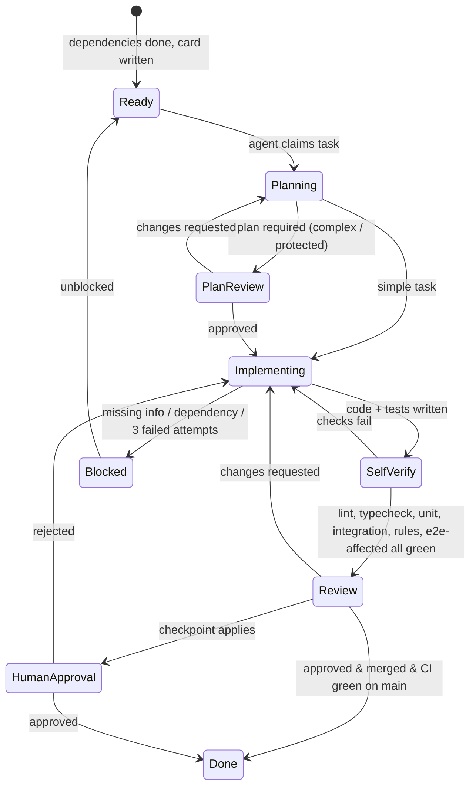

# 08 — AI-Agentic Development Workflow

> **Prev:** [07 SEO/AEO/Performance](07-seo-aeo-and-performance.md) · **Next:** [09 Testing & QA](09-testing-and-quality-assurance.md)
> Applies to every AI coding agent and human contributor. Where this document conflicts with an agent's default behavior, this document wins. Tasks come from [11 Roadmap](11-implementation-roadmap.md); traceability from [14](14-traceability-matrix.md).

## Contents

1. [Principles](#1-principles)
2. [Agent roles and responsibilities](#2-agent-roles-and-responsibilities)
3. [Task lifecycle](#3-task-lifecycle)
4. [Task card template](#4-task-card-template)
5. [Context handoff](#5-context-handoff)
6. [Shared coding standards](#6-shared-coding-standards)
7. [Human approval checkpoints](#7-human-approval-checkpoints)
8. [Guardrails: protected areas and prohibited actions](#8-guardrails-protected-areas-and-prohibited-actions)
9. [Code review and Definition of Done](#9-code-review-and-definition-of-done)
10. [Task tracking](#10-task-tracking)
11. [Failure recovery and rollback](#11-failure-recovery-and-rollback)
12. [Phase completion criteria](#12-phase-completion-criteria)
13. [Prompt templates](#13-prompt-templates)

---

## 1. Principles

1. **Small, verifiable tasks** — one task ≈ one PR, ≤ ~400 changed lines excluding tests/fixtures/generated files; each task has explicit acceptance criteria and tests.
2. **Inspect before changing** — agents read relevant existing code, tests, and these requirements before editing. No editing a file that hasn't been read in the current session.
3. **Plan before complex changes** — any task touching > 3 files, a protected area, schema, or public interfaces requires a written implementation plan approved by the Lead (and human if checkpoint applies) before code.
4. **Tests are part of the task** — no task is complete without automated tests proving its acceptance criteria.
5. **No silent decisions** — architectural deviations, new dependencies, or weakened controls are raised as questions/ADRs, never slipped in.
6. **Evidence over assertion** — completion claims include command outputs (tests, lint, typecheck, build).
7. **Requirements are the source of truth** — if code and requirements disagree, stop and raise it.

## 2. Agent roles and responsibilities

| Agent | Responsibilities | May modify | Must not |
|-------|-----------------|------------|----------|
| **Lead / Orchestrator** | Selects next task by dependency order, writes task cards, assigns agents, merges handoffs, tracks status, escalates | `requirements/tasks/*`, tracking files | Implement protected-area changes alone |
| **Architect** | ADRs, module boundaries, schema/index design, reviews plans for cross-cutting changes | `requirements/*` (via PR), ADR files, `firestore.indexes.json` (with Backend) | Change approved ADRs without human approval |
| **Backend** | Services, repositories, Server Actions, Route Handlers, Functions, migrations | `packages/core`, `packages/shared`, `apps/*/src/features/*/actions.ts`, `functions/` | Edit rules, authz core, session code without Security co-review |
| **Frontend** | Pages, components, design system, accessibility, responsive behavior | `apps/*/src/app`, `features/*/components`, `packages/ui` | Import server-only modules into client; bypass `packages/ui` |
| **Security** | Threat model, authz/session/rules/headers code, security reviews, isolation tests, dependency review | Protected areas (with human approval) | Approve own changes alone |
| **QA** | Test plans, unit/integration/E2E/a11y/visual tests, fixtures, flaky-test triage | `e2e/`, `**/*.test.ts`, `packages/testing` | Weaken assertions/thresholds to make tests pass |
| **DevOps** | CI/CD, environments, hosting config, monitoring, backups | `.github/`, `firebase.json`, `vercel.json`, `instances/`, infra scripts | Deploy to production without human approval |
| **Documentation** | Keeps requirements, README, runbooks, docs site, changelog current | `requirements/`, `docs/`, `README.md`, marketing docs content | Change requirement meaning without Lead/human approval |

A single agent instance may play several roles sequentially, but **author and reviewer must be different agent sessions** (fresh context) and a human reviews all protected-area changes.

## 3. Task lifecycle



Steps an agent must follow for each task:
1. Read the task card, linked requirements (FR/NFR), ADRs, and tests to satisfy.
2. Inspect existing code in affected areas (search for similar patterns; reuse utilities).
3. Write/attach plan (if required) — files to change, approach, risks, tests.
4. Write failing tests first for behavior (TDD encouraged; mandatory for authz/isolation/validation).
5. Implement minimal change satisfying acceptance criteria.
6. Run local verification: `pnpm lint && pnpm typecheck && pnpm test && pnpm test:rules` (+ `pnpm test:e2e --grep <area>` when UI touched).
7. Update docs/traceability if IDs or behavior changed.
8. Open PR with template ([§9](#9-code-review-and-definition-of-done)); hand off to reviewer.

## 4. Task card template

Stored at `requirements/tasks/T-PP-NN.md` (or as an issue with identical fields).

```markdown
# T-04-03 — Contacts module
- Phase: 4 (Core CRM) · Owner agent: Backend + Frontend · Reviewer: QA, Security (authz)
- Requirements: FR-CON-001..004, FR-SRCH-002 (contacts), NFR-SEC-001/002/004
- Depends on: T-03-01, T-03-02, T-03-06, T-03-07, T-04-01, T-04-02
- Protected areas touched: none (uses wrapper only) | YES → human checkpoint
## Scope
- In: create/read/update/soft-delete contacts; list with Q1–Q7 query shapes; detail page; duplicate warning
- Out: import (T-06-06), search tokens UI (T-06-01)
## Acceptance criteria
- (copied from 01 §7 with test IDs) …
## Tests to add/pass
- TC-CON-001..004, TC-SEC-001 (contacts rows), TC-SEC-010 (contact fields), TC-SRCH-002 (contacts)
## Plan (required? yes/no)
## Definition of Done checklist (see 08 §9)
## Handoff notes (filled at end)
```

## 5. Context handoff

Every task ends with a **handoff note** (in the task card and PR description):

```markdown
## Handoff
- Summary of change (3–5 bullets)
- Files touched (grouped by layer)
- New/changed public interfaces (function signatures, schemas, actions, routes)
- Decisions made + rationale (link ADR if any)
- Tests added (IDs) and commands run with results
- Known limitations / follow-ups (new task IDs proposed)
- Traceability updates (FR ↔ T ↔ TC)
```

Shared context files maintained in repo:
- `AGENTS.md` (and `CLAUDE.md` pointer) — condensed standards, commands, protected paths, links to requirements.
- `requirements/` — specification (this set).
- `requirements/tasks/STATUS.md` — task board snapshot ([§10](#10-task-tracking)).
- `requirements/decisions/ADR-NNN-*.md` — full ADR texts when created/superseded.

## 6. Shared coding standards

| Topic | Standard |
|-------|----------|
| Language | TypeScript `strict: true`, `noUncheckedIndexedAccess: true`, `exactOptionalPropertyTypes: true`; no `any` (lint error), `unknown` + narrowing instead |
| Style | ESLint (Next.js config + typescript-eslint strict + import/boundaries + security plugins) + Prettier; no disabled rules without inline justification and reviewer approval |
| Naming | `camelCase` vars/functions, `PascalCase` components/types, `kebab-case` files, Server Actions suffixed `Action` (`updateContactAction`) |
| Server/client | `import 'server-only'` in `packages/core`; `'use client'` only where needed; serializable props only |
| Data access | Only via repositories with `TenantContext`; never raw Admin SDK in features |
| Mutations | Only via `withTenantAction` / `withUserAction` / `withAgencyAction` / `withPlatformAction`; return `ActionResult` |
| Validation | Zod schemas in `packages/shared/schemas`; `.strict()` on server |
| Errors | Typed errors (`AppError` subclasses); no swallowed errors; no stack traces to client |
| Logging | `logger.{info,warn,error}` with structured fields; never log PII/secrets |
| Dates/money | `Timestamp` storage, `Intl` formatting; integer minor units |
| Strings | User-facing strings via message catalog (NFR-I18N-001) |
| Dependencies | New runtime dependency requires justification in PR (size, maintenance, license, security) and Architect approval |
| Comments | Explain *why*, not *what*; link requirement IDs for non-obvious rules (`// FR-RBAC-003: exactly one owner`) |
| Tests | Co-located `*.test.ts(x)`; integration tests in `packages/*/test/integration`; E2E in `e2e/` |
| Commits | Conventional Commits (`feat(contacts): …`), referencing task ID |

## 7. Human approval checkpoints

Agents must **stop and request human approval** before:

| # | Checkpoint | Evidence required |
|---|-----------|-------------------|
| H1 | Phase 0 plan approval (this document set) | Planning summary + open questions answered |
| H2 | Any ADR creation/supersession or architecture change (new service, new datastore, hosting change, client data access) | ADR draft with alternatives |
| H3 | Changes to authentication/session code, authz core (`authz.ts`, `tenant-context.ts`, `withTenantAction`), proxy routing, Firestore/Storage rules, security headers/CSP | Diff + Security agent review + tests |
| H4 | Database migrations, index removals, schema-breaking changes | Migration plan, dry-run results on staging, backup confirmation |
| H5 | Adding runtime dependencies with network/native access or > 50 KB gzip client impact | Justification |
| H6 | Production deployment and production configuration/secret changes | Release checklist ([13](13-release-readiness-checklist.md)) |
| H7 | Any change lowering a test threshold, coverage target, rate limit, or security setting | Rationale + risk acceptance |
| H8 | Data deletion/purge jobs run manually against staging/prod | Runbook + target list |
| H9 | IAM/service-account permission changes, Vercel ↔ GCP federation config | Diff of roles/claims |
| H10 | Payment gateway adapters, webhook handlers, subscription state machine, and anything touching gateway secrets | Security review + sandbox test evidence (TC-BILL-*) |
| H11 | Domain onboarding code (Vercel Domains API, authorized-domain sync) and new instance creation | Spike/test evidence; instance registry diff |

## 8. Guardrails: protected areas and prohibited actions

**Protected paths** (CODEOWNERS → human + Security agent review required):
```
firebase/firestore.rules
firebase/storage.rules
firebase/firestore.indexes.json          (Architect review; removal = H4)
packages/core/session.ts
packages/core/tenant-context.ts
packages/core/authz.ts
packages/core/actions/**
packages/core/repositories/base.ts
packages/shared/permissions.ts
apps/*/src/proxy.ts
apps/*/next.config.*
firebase.json
.github/workflows/**
functions/migrations/**
packages/core/payments/**
apps/web/src/app/api/webhooks/**
packages/core/domains/**
packages/core/contexts/**        (tenant / agency / platform contexts)
packages/core/repositories/scoped*.ts   (Member own-scope, ADR-023)
vercel.json, instances/**
```

**Prohibited actions** (automatic review rejection):
- `allow read, write: if true` or any rule broadening without ADR.
- Reading `tenantId`, `role`, or permissions from client input.
- Adding a Server Action or Route Handler without the wrapper/context call and an isolation test.
- Disabling, skipping (`.skip`, `.only` committed), or deleting tests to get green; lowering coverage thresholds.
- `eslint-disable` for security/boundary rules; `@ts-ignore` / `@ts-expect-error` without linked issue.
- `dangerouslySetInnerHTML` outside the sanitizer component.
- Committing secrets, `.env` files, service-account keys; logging PII.
- Using Admin SDK or `packages/core` from client components.
- Caching tenant data across requests without Security approval.
- Force-pushing to `main`, rewriting shared history, deploying to production, or running destructive commands against non-local projects.
- Changing requirement documents to match an implementation without Lead/human approval.
- Introducing new external services (SaaS) without ADR.
- Handling card/bank data, embedding gateway card fields, or logging raw gateway payloads.
- Granting entitlements from a client redirect or unverified webhook.
- Giving agency or platform contexts access to CRM subcollections, or bypassing Member own-scope query builders.

Automated enforcement: ESLint custom rules, CI grep checks (e.g., `if true` in rules, `.only(`), CODEOWNERS, branch protection, required checks ([10 §2](10-ci-cd-and-deployment.md#2-continuous-integration-and-quality-gates)).

## 9. Code review and Definition of Done

**PR template** (required sections): Task ID & requirement IDs · Summary · Plan link (if required) · Screenshots (UI; mobile + desktop) · Tests added (TC-IDs) · Commands run & results · Security considerations (authz, tenant isolation, input validation, data exposure) · Protected areas touched (Y/N) · Handoff notes.

**Reviewer checklist:**
- [ ] Matches acceptance criteria; no scope creep.
- [ ] Tenant context derived server-side; every new endpoint wrapped; isolation test present.
- [ ] Inputs validated; outputs escaped; no PII in logs.
- [ ] Query shapes declared with indexes.
- [ ] Accessible (labels, keyboard, focus, contrast) and responsive (screenshots).
- [ ] Tests meaningful (assert behavior, not implementation); no weakened assertions.
- [ ] Docs/traceability updated.

**Definition of Done (task):**
1. Acceptance criteria met and demonstrated by passing tests.
2. CI green: lint, typecheck, unit, integration, rules, E2E (affected + smoke), build, audit, bundle budget.
3. Reviewed by a different agent session (and human for protected areas/checkpoints).
4. Merged to `main`; staging deploy succeeded; smoke test passes.
5. Handoff note complete; `STATUS.md` and traceability updated.

## 10. Task tracking

- Source of truth: GitHub Issues/Projects (A-08) mirrored to `requirements/tasks/STATUS.md` by the Lead at each task transition.

```markdown
| Task | Title | Phase | Status | Agent | PR | Tests | Blocked by |
|------|-------|-------|--------|-------|----|-------|-----------|
| T-03-01 | Permission model & authorize() | 3 | Review | Security | #42 | TC-RBAC-002 ✓ | — |
```
- Status values: `Ready · Planning · PlanReview · Implementing · Review · HumanApproval · Done · Blocked`.
- WIP limit: ≤ 3 tasks `Implementing` concurrently; tasks touching the same protected file are serialized.

## 11. Failure recovery and rollback

| Situation | Procedure |
|-----------|-----------|
| Tests fail after implementation | Diagnose root cause (read error, reproduce, isolate) — no guess-and-retry loops. After **3 failed fix attempts**, stop, mark `Blocked`, write findings, escalate to Lead |
| Flaky test | QA quarantines with issue link (max 7 days), never deletes; root cause required to unquarantine |
| Agent produced wrong/unsafe change on branch | Discard branch or `git revert` specific commits; never force-push shared branches |
| Bad merge on `main` | `git revert` PR merge commit via new PR; staging auto-redeploys |
| Bad staging deploy | Promote previous Vercel deployment (instant rollback); redeploy previous rules/indexes tag ([10 §8](10-ci-cd-and-deployment.md#8-rollback)) |
| Migration failure | Stop job (idempotent checkpoint), assess, resume or run compensating migration; restore from PITR if data damaged (H4/H8 approval) |
| Lost context between sessions | Resume from task card handoff notes + PR description + `STATUS.md`; re-read touched files before continuing |
| Requirement ambiguity discovered | Stop; add `OQ-NN` to [00 §11](00-project-overview.md#11-open-questions); propose default; await Lead/human answer if critical |

## 12. Phase completion criteria

A phase in [11](11-implementation-roadmap.md) is complete when:
1. All tasks in the phase are `Done` (or explicitly deferred with human approval and traceability updated).
2. Phase test suite passes in CI on `main` and against staging.
3. Phase-specific completion criteria in [11](11-implementation-roadmap.md) are met.
4. No open Critical/High security findings introduced in the phase.
5. Phase review note written (what shipped, deviations, risks updated) and approved by Lead (and human for phases 0, 3, 9, 10, 11).

## 13. Prompt templates

**Implementation agent:**
```
You are the {Backend|Frontend} agent for task {T-ID}. Read: requirements/08 (rules), the task card,
requirements sections {links}, and existing code in {paths} before editing. Do not modify protected paths
(08 §8) unless the card says a human checkpoint is approved. Write tests {TC-IDs} first, implement the
minimal change, run `pnpm lint && pnpm typecheck && pnpm test && pnpm test:rules`, and finish with a
handoff note (08 §5). If requirements are ambiguous, stop and report the question instead of guessing.
```

**Review agent:**
```
You are the reviewer for PR {n} (task {T-ID}). Use a fresh context. Verify acceptance criteria against
tests, run the reviewer checklist (08 §9), and specifically try to find: missing authz, tenant ID taken
from input, unvalidated input, PII in logs, missing indexes, inaccessible UI. Report findings with
file:line and severity; do not fix them yourself.
```

**Security review agent:** as review agent plus: walk the threat model rows (04 §3) relevant to the diff; confirm protected-file changes have human approval recorded.
