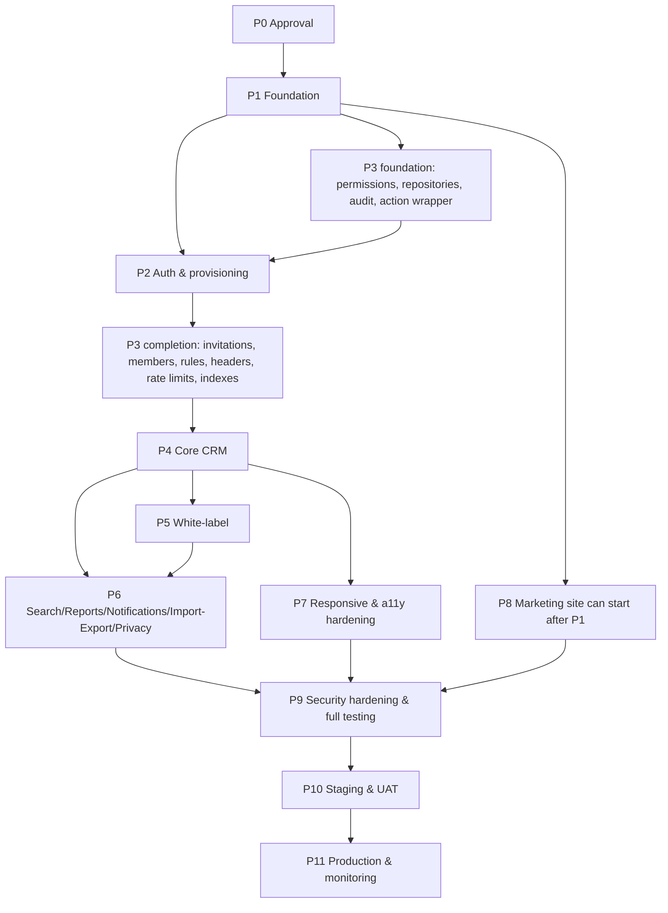

# 11 — Implementation Roadmap

> **Prev:** [10 CI/CD](10-ci-cd-and-deployment.md) · **Next:** [12 Environment & Configuration](12-environment-and-configuration.md)
> Phases are **milestone groupings**; individual tasks start as soon as their dependencies are `Done` (some Phase 3 foundation tasks run in parallel with Phase 2). Task workflow per [08](08-ai-agentic-development-workflow.md). Durations are rough estimates for a small team augmented by AI agents and are **[ASSUMPTION]** pending owner capacity input.

## Contents

- [Dependency overview](#dependency-overview)
- [Phase 0 — Requirements validation and architecture approval](#phase-0--requirements-validation-and-architecture-approval)
- [Phase 1 — Project foundation and development tooling](#phase-1--project-foundation-and-development-tooling)
- [Phase 2 — Authentication and tenant provisioning](#phase-2--authentication-and-tenant-provisioning)
- [Phase 3 — Authorization and database security](#phase-3--authorization-and-database-security)
- [Phase 4 — Core CRM modules](#phase-4--core-crm-modules)
- [Phase 5 — White-label customization](#phase-5--white-label-customization)
- [Phase 6 — Search, reporting, notifications, and integrations](#phase-6--search-reporting-notifications-and-integrations)
- [Phase 7 — Responsive UI and accessibility](#phase-7--responsive-ui-and-accessibility)
- [Phase 8 — SEO, AEO, and performance optimization](#phase-8--seo-aeo-and-performance-optimization)
- [Phase 9 — Security hardening and comprehensive automated testing](#phase-9--security-hardening-and-comprehensive-automated-testing)
- [Phase 10 — Staging validation and user acceptance testing](#phase-10--staging-validation-and-user-acceptance-testing)
- [Phase 11 — Production deployment and post-launch monitoring](#phase-11--production-deployment-and-post-launch-monitoring)
- [Post-MVP backlog](#post-mvp-backlog)

## Dependency overview

Estimated timeline (assumption, v1.1 with agencies, custom domains and billing): P0 1 wk · P1 2 wk · P2+P3 4 wk · P4 4 wk · P5 3 wk · P6 4.5 wk · P7 1.5 wk (overlapping) · P8 1.5 wk (overlapping) · P9 2.5 wk · P10 2 wk · P11 1 wk + 2 wk hypercare → **~25–28 weeks**.

---

## Phase 0 — Requirements validation and architecture approval

**Goal:** Approved plan, answered critical questions, frozen MVP scope.
**Prerequisites:** This document set.

| Task | Title | Reqs | Depends | Deliverable |
|------|-------|------|---------|------------|
| T-00-01 | Review plan v1.1; answer remaining OQs (critical: OQ-19 instance model, OQ-20 merchant of record, OQ-21 agency CRM access, OQ-22 agency provisioning, OQ-24 first production regions, OQ-25 plan pricing) | all | — | Answers recorded in [00 §11](00-project-overview.md#11-open-questions); docs updated |
| T-00-02 | Approve ADR-001..023 (or supersede) | — | T-00-01 | ADR status "Accepted" |
| T-00-03 | Freeze MVP scope & visual direction | 00 §3, 06 | T-00-01 | Signed-off scope list; brand placeholder decisions |
| T-00-04 | Select vendors, plans & domains: Vercel plan (domain limits, firewall, OIDC), email provider (per-agency sender domains), Upstash, Sentry, Razorpay/PayPal/Stripe test accounts, operator domains | OQ-06/07/11/16 | T-00-01 | Vendor list + DPAs initiated |
| T-00-05 | Compliance kickoff: privacy policy, terms, DPA drafting | OQ-12, 04 §16 | T-00-01 | Legal workstream owner & timeline |

**Risks:** delayed answers block P1 (esp. OQ-04 region, immutable). **Tests:** n/a (document review). **Completion criteria:** H1 approval recorded; all critical OQs answered or defaults explicitly accepted; traceability matrix re-validated.

---

## Phase 1 — Project foundation and development tooling

**Goal:** Repo, tooling, CI skeleton, emulators, environments, and coding standards ready for feature work.
**Prerequisites:** Phase 0 complete.

| Task | Title | Reqs | Depends | Deliverable | Tests |
|------|-------|------|---------|------------|-------|
| T-01-01 | Init pnpm monorepo, Next.js 16 apps (web, console), TS strict, ESLint (incl. boundaries), Prettier; verify Next 16 `proxy.ts` semantics | NFR-MAINT-001 | T-00-02 | Building skeleton apps | lint/typecheck pass |
| T-01-02 | Vitest workspace + RTL + axe setup | NFR-MAINT-001 | T-01-01 | Test runner config, sample tests | sample green |
| T-01-03 | Playwright setup (projects per browser & viewport, `*.localhost` host routing) | NFR-RESP-001 | T-01-01 | `e2e/` scaffold | smoke green |
| T-01-04 | Firebase emulator config, `packages/testing` (factories, scenarios Acme/Globex), rules test harness | NFR-SEC-003 | T-01-01 | `firebase.json` emulators, seed script | rules harness runs |
| T-01-05 | CI pipeline: install, lint, typecheck, unit, emulator tests, build, gitleaks, audit, CodeQL | NFR-MAINT-001, NFR-SEC-007, NFR-SEC-008 | T-01-02..04 | `.github/workflows/ci.yml`, branch protection, CODEOWNERS | TC-MAINT-001 |
| T-01-06 | Env validation module (`env.ts`), `.env.example` placeholders, secret conventions | NFR-SEC-007 | T-01-01 | Fail-fast config | unit tests |
| T-01-07 | Logging, requestId, error classes, `ActionResult`, error boundaries | NFR-OBS-001 | T-01-01 | `packages/core/logger`, errors | TC-OBS-001 (partial) |
| T-01-08 | Design tokens, base `packages/ui` primitives (Button, TextField, Dialog, Toast, Skeleton), message catalog | NFR-A11Y-001, NFR-I18N-001 | T-01-02 | UI catalog route | component + axe tests, TC-I18N-001 |
| T-01-09 | **Spike + provisioning:** create dev (US, proposed `us-east1`) and staging Firebase projects (Blaze + budget alerts); Vercel projects (web, console) with function region `iad1`; verify Vercel OIDC → GCP Workload Identity Federation for Admin SDK, Vercel Domains API (add/verify/remove, limits, wildcard nameserver requirement), cookie behavior, Node runtime, log drains; Firebase authorized-domains API & limits without Identity Platform; Firestore composite-index limit; free-tier/Blaze facts (A-14); IAM baseline; WIF for CI | NFR-PRIV-001, NFR-SEC-007, R-02, R-10, NFR-PERF-002 | T-00-04 | Spike report updating ADR-007/ADR-022/02 §4.5; projects live | TC-PRIV-004 |
| T-01-10 | `AGENTS.md`/`CLAUDE.md`, PR template, task card template, `STATUS.md` | — | T-01-01 | Agent context files | review |
| T-01-11 | Instance registry (`instances/*.json`), env config-as-code sync to Vercel, multi-instance release workflow skeleton | NFR-PRIV-001, NFR-REL-001 | T-01-05, T-01-09 | Registry + workflow (H11) | dry-run release to dev |

**Deliverables:** Running skeleton on staging; CI gates enforced. **Risks:** R-10 hosting gaps (spike may change ADR-007). **Completion criteria:** `pnpm dev` + emulators run locally per [12](12-environment-and-configuration.md); CI required checks active on `main`; staging serves skeleton on wildcard subdomain; spike report approved (H2 if ADR changes).

---

## Phase 2 — Authentication and tenant provisioning

**Goal:** Users can sign up, verify, create a workspace, and sign in on the tenant host with a secure session.
**Prerequisites:** Phase 1; T-03-01, T-03-02, T-03-06, T-03-07 (started in parallel).

| Task | Title | Reqs | Depends | Deliverable | Tests |
|------|-------|------|---------|------------|-------|
| T-02-01 | Auth UI on workspace & console hosts: sign-in (email/password; Google where host authorized), reset request; **no sign-up UI**; invitation acceptance page with server-side account creation (`createUser`) | FR-AUTH-001, FR-AUTH-002 | T-01-08, T-01-09, T-03-04 | Auth pages | TC-AUTH-001, TC-AUTH-002 |
| T-02-02 | Session cookie route handler (create/delete), `getSession`, CSRF, revocation, reauth helper | FR-AUTH-004, FR-AUTH-006, NFR-SEC-005 | T-01-06, T-01-07 | `session.ts`, `/api/auth/session` (H3) | TC-AUTH-004, TC-AUTH-005, TC-SEC-011 |
| T-02-03 | Password reset via Admin-generated links + email outbox (basic template); continue URL on canonical host | FR-AUTH-003 | T-02-02 | Reset flow | TC-AUTH-003 |
| T-02-04 | Workspace provisioning service (platform; entitled agency) incl. owner invitation, agency quota, idempotency; console form | FR-TEN-001, FR-TEN-003 | T-02-02, T-02-09, T-03-02, T-03-06 | Provisioning transaction | TC-TEN-001, TC-TEN-003 |
| T-02-05 | Proxy host classification + `resolveWorkspaceByHost` (tenantDomains, status active) + `requireTenantContext` (incl. agency status) | FR-TEN-004, NFR-SEC-001, NFR-SEC-002 | T-02-02, T-03-01 | Context resolver (H3) | TC-TEN-004, TC-SEC-015 (partial) |
| T-02-06 | Workspace switcher & multi-membership | FR-TEN-008 | T-02-05 | Switcher UI | TC-TEN-007 |
| T-02-07 | Platform console: Google-only sign-in for platform staff (domain allowlist), agencies/workspaces lists, provision, suspend/reactivate (workspace & agency) | FR-AUTH-008, FR-TEN-002 | T-02-04, T-02-05, T-02-10 | Console MVP (H3) | TC-AUTH-007, TC-TEN-002 |
| T-02-08 | Tenant-branded login page (default branding until P5), noindex | FR-PUB-003 | T-02-05 | Login page | TC-PUB-003 |
| T-02-09 | Agency entity, staff roles, staff invitations, `requireAgencyContext`, partners host shell; agency provisioning in platform console | FR-AGY-001, FR-AGY-002, FR-AGY-003 | T-02-02, T-03-01, T-03-07 | Agency foundation (H3) | TC-AGY-001, TC-AGY-002, TC-AGY-003 |
| T-02-10 | Privileged-account protections: console session lifetimes, re-auth helper for privileged actions, `privilegedSessions` + login-alert emails + "not me" revoke, privileged rate limits, optional IP allowlist; orphan-account cleanup job | FR-AUTH-008, FR-AUTH-001 | T-02-02, T-03-08 | Controls (H3) | TC-AUTH-007 |

**Risks:** R-02 OAuth domains; session cookie forwarding by hosting. **Completion criteria:** E2E journey 1 ([09 §7](09-testing-and-quality-assurance.md#7-end-to-end-tests)) green on staging; H3 approvals recorded for session/proxy/context code.

---

## Phase 3 — Authorization and database security

**Goal:** Enforced RBAC, tenant-scoped data layer, audit, rules, headers, rate limits, invitations, member management.
**Prerequisites:** Phase 1 (foundation tasks), Phase 2 for invitations/members.

| Task | Title | Reqs | Depends | Deliverable | Tests |
|------|-------|------|---------|------------|-------|
| T-03-01 | Permission constants, workspace role matrix (Member `own` scope), agency & platform permissions, `authorize()`, record-scope helpers | FR-RBAC-002, FR-AGY-002, NFR-SEC-002 | T-01-02 | `permissions.ts`, `authz.ts` (H3) | TC-RBAC-002 |
| T-03-02 | Scoped repository base (`tenantCollection`, `scopedQuery` with Member own-scope, `canReadRecord`), agency-metadata repository, converters, lint rule banning raw Firestore in features | NFR-SEC-001, FR-RBAC-004 | T-01-04 | `repositories/base.ts`, `scoped*.ts` (H3) | TC-SEC-001 (framework), TC-RBAC-004 (framework) |
| T-03-03 | Firestore & Storage deny-all rules + rules tests + CI grep | NFR-SEC-003, FR-AUD-003 | T-01-04 | rules files (H3) | TC-SEC-003, TC-AUD-003 (rules part) |
| T-03-04 | Invitations: create, email, accept, revoke, expire; seat check | FR-RBAC-001, FR-AUTH-001 | T-02-05, T-03-07 | Invitation flows | TC-RBAC-001 |
| T-03-05 | Member management: role change, removal w/ reassignment, forced sign-out, ownership transfer | FR-RBAC-003, FR-RBAC-007, FR-AUTH-006 | T-03-04 | Members settings page | TC-RBAC-003, TC-RBAC-005, TC-AUTH-005 |
| T-03-06 | Audit service (in-transaction writes, action allowlist, TTL field) | FR-AUD-001, FR-AUD-003 | T-01-07 | `audit.ts` | TC-AUD-001, TC-AUD-003 |
| T-03-07 | Shared Zod schemas baseline + `withTenantAction`/`withUserAction`/`withAgencyAction`/`withPlatformAction` wrappers + action registry for isolation suite | NFR-SEC-004, NFR-SEC-002 | T-03-01, T-03-02 | Wrapper (H3) | TC-SEC-002, TC-SEC-004, TC-SEC-005 |
| T-03-08 | Rate limiter module + policies | NFR-SEC-006 | T-00-04, T-01-06 | `rate-limit.ts` | TC-SEC-007 |
| T-03-09 | Security headers, CSP (nonce strategy), HSTS, `Cache-Control` policy | NFR-SEC-005, NFR-SEC-010, NFR-SEC-001 | T-02-05 | headers config (H3) | TC-SEC-006, TC-SEC-013, TC-SEC-014 |
| T-03-10 | `firestore.indexes.json` for Q1–Q32 + Member own-scope variants + index-coverage CI check + TTL policy script | FR-SRCH-002, FR-RBAC-004, NFR-COST-001 | T-03-02 | Index file, check script | index check job |

**Risks:** R-01 (missed checks) — mitigated by registry-based isolation suite. **Completion criteria:** Isolation & privilege suites run in CI for all existing actions; rules tests green; security agent sign-off + human approval (H3) for all protected files.

---

## Phase 4 — Core CRM modules

**Goal:** Full CRUD and workflows for companies, contacts, leads, deals, tasks, activities with ownership, tags, trash, settings.
**Prerequisites:** Phase 3.

| Task | Title | Reqs | Depends | Deliverable | Tests |
|------|-------|------|---------|------------|-------|
| T-04-01 | List infrastructure: DataTable, filter bar, allowlisted query shapes, signed cursors, URL state | FR-SRCH-002 | T-03-10, T-01-08 | Reusable list kit | TC-SRCH-002 |
| T-04-02 | Companies module (list, detail, form, duplicate domain) | FR-COM-001..003 | T-04-01 | Companies | TC-COM-001..003 |
| T-04-03 | Contacts module (incl. company link, duplicate email, lifecycle, Customers view) | FR-CON-001..004 | T-04-02 | Contacts | TC-CON-001..004 |
| T-04-04 | Leads module + conversion transaction + relink job | FR-LEAD-001..003 | T-04-03 | Leads | TC-LEAD-001..003 |
| T-04-05 | Pipeline settings + deals module + kanban (DnD + keyboard) + win/loss (+ won → customer prompt) | FR-DEAL-001..004, FR-CON-004 | T-04-03 | Deals & board | TC-DEAL-001..004 |
| T-04-06 | Tasks module + My tasks | FR-TASK-001, FR-TASK-002 | T-04-01 | Tasks | TC-TASK-001, TC-TASK-002 |
| T-04-07 | Activities, composer, timeline, system activities, SafeMarkdown | FR-ACT-001, FR-ACT-002, NFR-SEC-004 | T-04-02 | Timeline | TC-ACT-001, TC-ACT-002, TC-SEC-010 |
| T-04-08 | Own-scope verification across all modules (lists, detail, search hooks, kanban, bulk actions), reassignment, related-record labels | FR-RBAC-004 | T-04-02..T-04-06 | Ownership checks | TC-RBAC-004 |
| T-04-09 | Soft delete, Trash page, restore, purge scheduler | FR-REC-001 | T-04-02..T-04-07 | Trash | TC-REC-001 |
| T-04-10 | Tags (catalog, TagInput, filters) | FR-REC-002 | T-04-02 | Tags | TC-REC-002 |
| T-04-11 | Tenant settings & user profile/preferences | FR-SET-001, FR-SET-002 | T-03-07 | Settings pages | TC-SET-001, TC-SET-002 |

**Risks:** index gaps (R-04), denormalization drift. **Completion criteria:** E2E journeys 3, 4, 5, 9, 11, 15 green; isolation suite covers all new actions; read budgets measured (TC-COST-001 baseline).

---

## Phase 5 — White-label customization

**Goal:** Agency/workspace branding with inheritance, custom & agency domains, branded emails and sender domains, agency console, plans/entitlements/flags.
**Prerequisites:** Phase 4 (shell exists), T-03-08.

| Task | Title | Reqs | Depends | Deliverable | Tests |
|------|-------|------|---------|------------|-------|
| T-05-01 | Branding settings + secure upload pipeline (sharp re-encode, brand-assets bucket, content-hash); apply branding to login page | FR-BRAND-001, NFR-SEC-009, FR-PUB-003 | T-04-11 | Branding page | TC-BRAND-001 |
| T-05-02 | Theme derivation + CSS variable injection + live preview | FR-BRAND-002 | T-05-01 | Theming | TC-BRAND-002 |
| T-05-03 | Email service abstraction + provider adapter + branded templates + overrides + test send | FR-BRAND-003 | T-00-04, T-02-03 | Email module | TC-BRAND-003 |
| T-05-04 | Plans, entitlements, feature flags, config resolution, limit enforcement, powered-by | FR-PLAN-001, FR-PLAN-004, FR-BRAND-004 | T-03-07 | Entitlements | TC-PLAN-001, TC-PLAN-003, TC-BRAND-004 |
| T-05-05 | Usage counters, usage page, warnings, nightly reconciliation (workspace + agency quotas) | FR-PLAN-002 | T-05-04 | Usage page | TC-PLAN-002 |
| T-05-06 | Branding inheritance platform → agency → workspace, `allowWorkspaceBranding` gate, resolved-branding trigger | FR-AGY-004 | T-05-02, T-02-09 | Inheritance | TC-AGY-004 |
| T-05-07 | Domain management: Vercel Domains API client, domain wizard, verification job, authorized-domain sync, canonical switch + redirects, removal; agency base domains | FR-TEN-005, FR-TEN-009 | T-02-05, T-01-09 | Domains (H11) | TC-TEN-008, TC-TEN-009 |
| T-05-08 | Agency sender domain verification with email provider | FR-BRAND-005 | T-05-03 | Sender domains | TC-BRAND-003 (sender cases) |
| T-05-09 | Agency console UI: workspaces table/detail, branding, domains, staff, settings | FR-AGY-005, FR-TEN-002 | T-02-09, T-05-06, T-05-07 | Partners console | TC-AGY-005 |

**Risks:** email deliverability (R-11), phishing abuse (R-13). **Completion criteria:** E2E journey 8 green; branded emails verified in staging inbox (SPF/DKIM pass); extreme-brand visual tests pass contrast.

---

## Phase 6 — Search, reporting, notifications, and integrations

**Goal:** Search, dashboard, reports, notifications, import/export, audit viewer, privacy tools, tenant export/deletion.
**Prerequisites:** Phase 4, Phase 5 (email).

| Task | Title | Reqs | Depends | Deliverable | Tests |
|------|-------|------|---------|------------|-------|
| T-06-01 | Search tokens on write + backfill + global search UI (command palette) | FR-SRCH-001 | T-04-02..T-04-05 | Search | TC-SRCH-001 |
| T-06-02 | Dashboard KPIs (aggregation queries), role scope | FR-DASH-001, FR-DASH-002 | T-04-05, T-04-06 | Dashboard | TC-DASH-001, TC-DASH-002 |
| T-06-03 | Standard reports + accessible tables + CSV export | FR-RPT-001, FR-RPT-002 | T-06-02 | Reports | TC-RPT-001, TC-RPT-002 |
| T-06-04 | In-app notifications (events, polling endpoint, bell, panel) | FR-NOTF-001, FR-LEAD-003 | T-04-04 | Notifications | TC-NOTF-001 |
| T-06-05 | Email notifications + preferences + unsubscribe + task reminder scheduler | FR-NOTF-002, FR-TASK-003 | T-06-04, T-05-03 | Reminders | TC-NOTF-002, TC-TASK-003 |
| T-06-06 | CSV import wizard + chunked function jobs + error report | FR-IMP-001, NFR-SEC-009 | T-04-03, T-05-04 | Import | TC-IMP-001 |
| T-06-07 | List CSV export + full tenant export jobs + signed URLs | FR-IMP-002, FR-TEN-007 | T-04-01 | Exports | TC-IMP-002, TC-TEN-006 |
| T-06-08 | Audit log viewer + export | FR-AUD-002 | T-03-06 | Audit page | TC-AUD-002 |
| T-06-09 | Privacy tools: contact DSAR export/erasure, erasure log, account deletion | FR-PRIV-001..003 | T-04-07 | Privacy settings | TC-PRIV-001..003 |
| T-06-10 | Tenant deletion workflow (request, cancel, purge job, slug quarantine) | FR-TEN-006 | T-02-07 | Deletion flow | TC-TEN-005 |

| T-06-11 | Payment gateway abstraction + **Razorpay** adapter + per-agency credential storage (Secret Manager) + plan price mapping/validation + webhook route (signature, idempotency) + `applyPaymentEvent` + nightly reconciliation (verify current Razorpay APIs/webhook scheme first) | FR-BILL-001, FR-BILL-003, NFR-SEC-011 | T-02-09, T-05-04 | Payments core (H10) | TC-BILL-001, TC-BILL-003, TC-SEC-016 |
| T-06-12 | Subscription lifecycle (trial/active/past_due/read_only/cancelled), billing page, hosted checkout redirect, payment history, manual billing mode, read-only enforcement | FR-BILL-002, FR-BILL-004, FR-BILL-005 | T-06-11 | Billing UX (H10) | TC-BILL-002, TC-BILL-004, TC-BILL-005 |
| T-06-13 | **PayPal** and **Stripe** adapters passing the shared contract suite | FR-BILL-001 | T-06-11 | Adapters (H10) | TC-BILL-001 |
| T-06-14 | Agency usage reporting + CSV | FR-AGY-006 | T-05-09 | Agency report | TC-AGY-006 |

"Integrations" in MVP = email provider, CSV, payment gateways (Razorpay, PayPal, Stripe), Vercel Domains API; Gmail/Outlook sync and public webhooks/API are post-MVP.

**Risks:** search UX (R-03), cost of aggregations, function idempotency. **Completion criteria:** E2E journeys 6, 7, 10, 14 green; function idempotency tests green; cross-tenant leakage tests (TC-SEC-012) cover search/report/export/notifications.

---

## Phase 7 — Responsive UI and accessibility

**Goal:** Systematic responsive and WCAG 2.2 AA conformance across all MVP screens.
**Prerequisites:** Phase 4 screens (runs alongside P5/P6, final pass after P6).

| Task | Title | Reqs | Depends | Deliverable | Tests |
|------|-------|------|---------|------------|-------|
| T-07-01 | Responsive audit & fixes (viewport matrix) | NFR-RESP-001 | T-04-* | Fixes | TC-RESP-001 |
| T-07-02 | Accessibility audit (axe all routes + manual SR) & fixes | NFR-A11Y-001 | T-04-*, T-06-* | Audit report + fixes | TC-A11Y-001, TC-A11Y-003 |
| T-07-03 | Keyboard journey suite & non-drag alternatives verification | NFR-A11Y-001, FR-DEAL-003 | T-04-05 | Keyboard tests | TC-A11Y-002, TC-DEAL-003 |
| T-07-04 | Visual regression baselines (light/dark, extreme brand) | NFR-RESP-001 | T-05-02 | Snapshots | TC-VIS-001 |
| T-07-05 | Loading/empty/error/offline/session-expired states completeness review | 06 §9 | T-06-* | State coverage | E2E journey 16 |

**Completion criteria:** 0 serious/critical axe violations; keyboard journeys pass; SR checklist has no blockers; viewport matrix green.

---

## Phase 8 — SEO, AEO, and performance optimization

**Goal:** Public site live-ready with SEO/AEO; performance budgets met in app and site.
**Prerequisites:** Phase 1 (marketing can start early); app perf work after Phase 6.

| Task | Title | Reqs | Depends | Deliverable | Tests |
|------|-------|------|---------|------------|-------|
| T-08-01 | Marketing pages (Home, Features, Pricing, Security, About, Contact, Legal) | FR-PUB-001 | T-01-08, T-00-05 | Pages | TC-PUB-001 |
| T-08-02 | Docs/help center + FAQ + glossary + client-side docs search | FR-PUB-002 | T-08-01 | Docs | TC-PUB-002 |
| T-08-03 | Metadata, canonicals, host-aware robots, sitemap, OG images, JSON-LD helpers | NFR-SEO-002 | T-08-01 | SEO infra | TC-SEO-002 |
| T-08-04 | Index-policy enforcement on tenant/console/assets hosts + tests | NFR-SEO-001 | T-02-05 | Headers/robots | TC-SEO-001 |
| T-08-05 | Performance pass: bundle analysis, dynamic imports, image/font, Lighthouse CI budgets, RUM (public) | NFR-PERF-001, NFR-PERF-003 | T-06-* | Budgets enforced | TC-PERF-001 |
| T-08-06 | Firestore cost review vs read budgets; billing alerts | NFR-COST-001 | T-06-* | Cost report | TC-COST-001 |

**Completion criteria:** Lighthouse thresholds met; TC-SEO-001/002 green; read budgets within targets.

---

## Phase 9 — Security hardening and comprehensive automated testing

**Goal:** Independent verification that security and quality targets are met.
**Prerequisites:** Phases 4–8 feature-complete.

| Task | Title | Reqs | Depends | Deliverable | Tests |
|------|-------|------|---------|------------|-------|
| T-09-01 | Threat-model review + full security code review of protected areas | NFR-SEC-* | P4–P8 | Review report | — |
| T-09-02 | Complete isolation/privilege suites (tenant, agency, platform, Member own-scope registries 100%), E2E cross-tenant/agency replay tests | NFR-SEC-001, NFR-SEC-002, FR-AGY-003 | T-09-01 | Suite complete | TC-SEC-001, -002, -004, -012, -013, -015, TC-AGY-003, TC-RBAC-004 |
| T-09-03 | DAST (ZAP baseline + authenticated scan) on staging; fix Highs | NFR-SEC-005 | T-01-09 (staging env), T-09-01 | ZAP report | SAC-13 |
| T-09-04 | Secret/bundle scan and dependency remediation; SBOM | NFR-SEC-007, NFR-SEC-008 | — | Clean reports | TC-SEC-008, TC-SEC-009 |
| T-09-05 | Coverage thresholds enforced; gap tests written | NFR-MAINT-001 | — | Coverage report | TC-MAINT-001 |
| T-09-06 | Load test (k6) at A-06 + session revocation latency check | NFR-PERF-002 | staging | Load report | TC-PERF-002 |
| T-09-07 | External penetration test (recommended) incl. payments, webhooks, domains, privileged accounts + remediation | NFR-SEC-001, NFR-SEC-011 | T-09-02 | Pentest report | — |
| T-09-08 | Observability verification: log fields, PII redaction, alerts wiring | NFR-OBS-001 | T-01-07 | Verified dashboards | TC-OBS-001 |

**Completion criteria:** No open Critical/High findings; all RB tests green; coverage thresholds met; human approval of security sign-off.

---

## Phase 10 — Staging validation and user acceptance testing

| Task | Title | Reqs | Depends | Deliverable | Tests |
|------|-------|------|---------|------------|-------|
| T-10-01 | Staging production-parity check (config, IAM, domains, backups, rules) | NFR-REL-* | P9 | Parity checklist | — |
| T-10-02 | Seed UAT data; onboard ≥ 1 pilot agency with ≥ 3 client workspaces (one custom domain, one agency subdomain) and Razorpay test-mode subscriptions | G-2, G-7 | T-10-01 | UAT environment | — |
| T-10-03 | Execute UAT scripts (UC-01..UC-13), timed onboarding (G-2), payment flows in test mode (G-7) | all FR | T-10-02 | UAT report & sign-off | UAT |
| T-10-04 | Backup/PITR restore drill + erasure re-application | NFR-REL-002 | T-10-01 | Drill report (RTO measured) | TC-REL-001 |
| T-10-05 | Defect triage & fixes; regression run | — | T-10-03 | Zero open SEV1/SEV2 defects | full suite |

**Completion criteria:** UAT sign-off; drill within RTO; 24-h soak without SEV2+.

---

## Phase 11 — Production deployment and post-launch monitoring

| Task | Title | Reqs | Depends | Deliverable | Tests |
|------|-------|------|---------|------------|-------|
| T-11-01 | Production hardening per instance: IAM & federation review, key-creation org policy, PITR + backup schedules, budgets (GCP + Vercel), Data Access logs, Google Workspace 2SV enforcement evidence for platform staff | NFR-REL-002, NFR-SEC-007, NFR-SEC-010, NFR-COST-001, FR-AUTH-008 | P10 | Hardened instance | checklist |
| T-11-02 | Monitoring/alerting/uptime/Error Reporting/dashboards in prod | NFR-OBS-001, NFR-REL-001 | T-11-01 | Alerts live | TC-REL-002 |
| T-11-03 | DNS (operator domains, `app.` delegation to Vercel for wildcard), certificates, email domain auth (SPF/DKIM/DMARC), CAA; pilot custom domains live | FR-TEN-004, FR-TEN-005, NFR-SEC-010 | T-11-01 | Domains live | TC-SEC-014, TC-TEN-008 |
| T-11-04 | Execute release checklist; go/no-go; production rollout (H6) | all | T-11-01..03 | v1.0.0 live | smoke |
| T-11-05 | Hypercare 2 weeks: daily dashboard review, triage, quick fixes | — | T-11-04 | Hypercare report | — |
| T-11-06 | Incident runbooks + on-call rota | 10 §11 | T-11-02 | Runbooks | tabletop exercise |

**Completion criteria:** [13](13-release-readiness-checklist.md) fully checked; 14 days post-launch without SEV1; postmortems (if any) closed.

---

## Post-MVP backlog

Ordered suggestion (subject to owner priorities): **FR-AUTH-005 MFA (Identity Platform) — highest priority post-launch (R-15)** · FR-AUTH-007 SSO · white-labelled agency console (OQ-23) · operator-to-agency automated billing · FR-REC-003 custom fields · FR-SRCH-003 saved views · FR-SRCH-004 external search · FR-DEAL-005 multiple pipelines · FR-ACT-003/004 email send & sync · FR-LEAD-004 web-to-lead · FR-RBAC-005/006 teams & custom roles · FR-TASK-004 recurring tasks · FR-RPT-003 report builder · FR-NOTF-003 push · FR-IMP-003 CRM importers · public API & webhooks (with SSRF guard).
